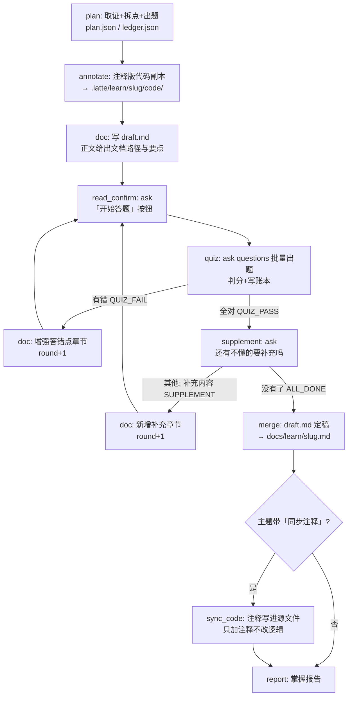

# learn_loop v2 设计：文档驱动的学习循环

> 状态：设计稿（未实现）
> 分支：feat/learn-loop-doc-driven
> 前身：config/workflows/learn_loop.toml（teach 正文讲解 → 弹窗出题）

## 1. 背景与要解决的问题

现有 learn_loop 的教学载体是 **teach 步的 chat 正文**：模型讲完一段立刻弹窗考人。
问题：

1. 讲解内容散落在消息流里，学员无法整体回看、没有结构化材料（没有数据结构、
   运行原理、模块交互、流程图这种成体系的组织）。
2. "讲完立刻考"——学员没有"先学后考"的节奏控制，想再看一遍只能往上翻消息。
3. 答错后重讲还是一段新消息，知识没有沉淀成可修订的文档。
4. 学完没有交付物：plan.json / ledger.json 是账本，不是给人看的文档。

v2 把教学载体从"chat 消息"改为"**持续演化的 markdown 文档**"：先写文档 → 学员
自己阅读 → 主动点「开始答题」→ 答错则把薄弱点增强进文档 → 答对则询问是否有
不懂的知识点要补充进文档 → 全部答对且无疑问 → 合并定稿，学习结束。

## 2. 目标流程（用户视角）

```
写/更新文档(draft.md) → chat 显示文档路径与本轮要点 → 学员阅读
        ↓ 学员点「开始答题」（按钮 = ask 弹窗）
      弹窗出题（全部未掌握点一次考完）→ 判分、写账本
        ├─ 有错 → 把答错要点的讲解增强进 draft.md → 回到"阅读"（新一轮）
        └─ 全对 → 弹窗问"还有不懂的知识点要补充吗？"
              ├─ 有（自由文本说明）→ 补充进 draft.md → 回到"阅读"（新一轮）
              └─ 没有 → 文档合并定稿 → 学习报告，结束
```

退出条件：**本轮题目全对 且 学员没有补充问题**。

## 3. 引擎机制约束（设计必须遵守的事实）

这些是从代码里核实过的硬约束，不是约定俗成：

1. **ask 阻塞发生在 step 中途，而 step 正文只在 step 结束时才投递到 UI**
   （workflow.rs 现有注释，learn_loop.toml:14-15 的教训）。所以"文档路径消息"
   必须由**上一个 step（doc）的正文**交付，「开始答题」按钮单独占一个 step
   （read_confirm），两者不能合并。
2. **每个 step 是全新 subagent，无跨次记忆**；跨 step 状态只能走文件
   （plan.json / ledger.json / draft.md）+ output_key 文本替换。
3. **`loop_until` 是全文子串匹配**（不是末行匹配），末行状态标记要靠
   `output_contract.last_line_prefix_any` 单独钉住。
4. **返工路由**：step 产出不含 `loop_until` 标记时，先按 `loop_back_routes`
   （标记 → 目标 step）路由，回落 `loop_back_to`，再回落自身；被返工 step 的
   产出会作为 `pending_feedback` 预置进目标 step 的 prompt——quiz 的判分结果
   由此自动成为 doc 步"该增强哪里"的输入。
5. **`max_iterations` 硬上限 10**，是死循环保险丝；撞满且无 advisor 兜底则
   workflow 失败。
6. **ask 的 `allow_repeat` / `shuffle` / `auto_answer` 参数未实现**（controller.rs
   register_ask_tool 不解析这三个键，config/prompts/tools/ask.md 是失实文档）。
   两个直接后果：
   - **同一 question 文本重问会被 `AnswerLog::recall` 静默回放旧答案、不弹窗**。
     重考同一知识点时必须在题面加区分后缀（如 `［第2轮］`）绕过。
   - 选项洗牌不存在：plan 步出题时**自己把正确项放在随机位置**（判分按 label
     文本，与位置无关）。
7. **ask 前端永远附带「其他（自定义）」自由文本入口**（chat_impl.ts:1135），
   答案是 `"其他：<用户文本>"`——"还有不懂的知识点"用这个通道收集，不需要
   新增协议。
8. **ask 支持 `questions=[...]` 一次多题**（多题弹框已实现，收齐才返回），
   配合 `tool_call_limits = { ask = 1 }` 表达"一轮只弹一次窗"。
9. **Web UI 可内嵌预览 md 文档**（2026-09-14 起）：消息里的本地 `.md`
   链接（`.latte/learn/`、`docs/` 白名单，经 /api/doc 只读路由）点击后
   在弹窗里渲染全文（带 TOC）；图片经 /api/doc-asset 加载。学员也可以
   在编辑器/终端里打开原文件；编辑器宿主（latte-code-editor）下可走
   `host.openDoc`（host.ts:42）。DocCard 事件属于可选的后续增强（见 §8）。
   （mermaid 已于 2026-09-14 支持：chat 内的 ```mermaid 围栏会渲染为 SVG。）
10. **改 config/workflows/learn_loop.toml 必须同步 .latte/workflows.d/**
    （sync-config.sh；workflow.rs 里有 sync 测试强制），且
    `learn_loop_workflow_structure`（workflow.rs:6557）等结构测试要跟着改。

## 4. 数据结构

所有文件在 `.latte/learn/<slug>/` 下；最终交付文档在 `docs/learn/<slug>.md`
（与 learn.toml 的产物约定一致）。

### 4.1 plan.json（plan 步一次性产出，后续只读）

在现有结构上加两个字段：

```json
{
  "slug": "rust-ownership",
  "topic": "Rust 所有权",
  "doc_outline": ["它是什么、整体怎么运转", "核心数据结构", "模块交互", "流程图"],
  "knowledge_points": [
    {
      "id": "k1",
      "title": "所有权规则",
      "evidence": "src/ownership.rs:12-48",
      "teach_points": ["每个值有唯一 owner（src/ownership.rs:12）"],
      "doc_section": "## 1. 所有权规则",
      "question": "…",
      "options": [{"label": "move 语义", "description": "…"}],
      "answer": "borrow 语义"
    }
  ]
}
```

- `doc_outline`：doc 步写文档的章节骨架（主题相关，如数据结构 / 运行原理 /
  模块调用交互 / 流程图），由 plan 按 topic 定制。
- `doc_section`：该知识点在 draft.md 里对应的章节标题，doc 步增强/补充时按
  它定位，quiz 反馈时告诉学员"该看哪一节"。
- `options` 里禁止 `recommended`（前端渲染成「✓ 推荐」= 泄题）；正确项位置由
  plan 自己随机化（无 shuffle 实现，见 §3.6）。

### 4.2 ledger.json（每轮由 quiz / supplement 步更新）

```json
{
  "slug": "rust-ownership",
  "round": 2,
  "knowledge_points": [
    {"id": "k1", "title": "所有权规则", "wrong": 0, "passed": true}
  ],
  "supplements": [
    {"round": 1, "asked": "用户补充提问原文", "doc_section": "## 5. 补充：…"}
  ],
  "updated_at": "<now>"
}
```

- 仍然**只记事实、不写状态名**：`wrong` / `passed` 推导掌握状态。
- `round`：文档演化轮次（每次因答错或补充回到 doc 步 +1），quiz 重考时用它
  生成题面后缀 `［第N轮］` 绕过 AnswerLog 回放（§3.6）。
- `supplements`：学员主动补充的问题及落入文档的章节，merge 步据此把补充章节
  并入正文结构。

### 4.3 draft.md（学习期间的活文档）

`.latte/learn/<slug>/draft.md`，单文件、按 `doc_outline` 组织章节：

- 每个知识点一节（标题 = `doc_section`），含 teach_points 展开、`file:line`
  出处、代码摘录、必要的流程图。结构图/调用图用 `code_graph(graph=…)` 从
  索引/AST 生成（证据级、不编造符号）；概念性流程图手写 mermaid，节点名
  必须来自取证过的真实符号。chat 与文档预览都把 ```mermaid 渲染为 SVG。
- 答错增强：在对应章节内补充"易错点辨析"小节（正确项 vs 干扰项的区别）。
- 学员补充：追加 `## 补充：<问题>` 章节。
- 全程原地演进，**不产生多版本文件**——合并压力集中在 merge 步一次完成。

### 4.4 最终文档

`docs/learn/<slug>.md`：merge 步把 draft.md 定稿（重排章节、合并补充内容、
生成目录、去掉轮次痕迹），这是学习流程的交付物。

### 4.5 注释版代码副本（2026-09-15 增补，2026-09-16 改为默认生成）

annotate 步（默认必跑）为每个知识点的 `evidence` 生成
`.latte/learn/<slug>/code/<知识点id>-<原文件名>`：逐字保留代码原文、
只加中文注释（文件头标出处与"学习副本，源文件未改动"），外加 `README.md`
索引。**只读源码、只写 `.latte/` 下的副本**——learn_loop 是只读类型
（isolated=false、paths 严格校验不许新建仓库文件），副本目录不违反该假设；
"不动源码"靠 annotate 步的 tools 白名单（只有 read + write，没有 edit）隔离。
supplement 新增知识点时由 doc 步补生成对应副本。

可选开关：主题带「同步注释」（或「写进源码」）时，merge 之后的 sync_code 步
把副本里的注释写进真实源文件（只加注释、不改逻辑）——这一步**会修改仓库
代码**，建议该任务开 isolated worktree（看板编辑弹窗可覆盖）。

## 5. Step 定义（workflow 层）

```
plan → annotate → doc → read_confirm → quiz → supplement → merge → [sync_code?] → report
             ↑__________|        |
             ↑__QUIZ_FAIL__|     |__SUPPLEMENT（有补充）
                           └ALL_DONE→ merge
```

| step | role | tools | 行为钉住（引擎字段） | 末行标记 |
|---|---|---|---|---|
| plan | tutor | read, code_graph, search, write | require_tools_any=[read,code_graph,search]；require_tools=[write]；output 仅 slug（max_chars） | — |
| annotate | tutor | read, write | require_tools=[write]；无 edit/ask（不动源码靠工具隔离） | — |
| doc | tutor | read, code_graph, search, write | require_tools=[write]；min_chars | 无状态行（正文含 draft.md 路径 + 本轮要点 + "看完点「开始答题」"） |
| read_confirm | tutor | ask | require_tools=[ask]；tool_call_limits={ask=1} | — |
| quiz | tutor | read, write, ask | require_tools=[ask,write]；tool_call_limits={ask=1}；require=[判分结果, 你选的是]；last_line_prefix_any=[QUIZ_PASS, QUIZ_FAIL]；loop_until=QUIZ_PASS；loop_back_routes={QUIZ_FAIL: doc}；max_iterations=10 | QUIZ_PASS / QUIZ_FAIL |
| supplement | tutor | read, write, ask | require_tools=[ask,write]；tool_call_limits={ask=1}；last_line_prefix_any=[ALL_DONE, SUPPLEMENT]；loop_until=ALL_DONE；loop_back_to=doc；max_iterations=10 | ALL_DONE / SUPPLEMENT |
| merge | tutor | read, write | require_tools=[write]；require=[docs/learn/] | — |
| sync_code（可选） | tutor | read, edit | when_any=[同步注释, 写进源码]（未命中整步跳过）；require_tools=[edit] | — |
| report | tutor | read | min_chars；require=[掌握进度] | — |

### 5.1 plan（基本沿用现有设计）

取证 → 拆 3-6 个由浅入深的知识点 → 出题（选项自己乱序、禁 recommended）→
写 plan.json（含 `doc_outline` / `doc_section`）与初始 ledger.json（round=0）。
产出只输出 slug（下游拼路径，max_chars 硬约束保留）。slug 推导时剔除
「同步注释」/「写进源码」开关标记词——它们是 sync_code 步的触发开关，
不是主题内容。

小白友好（2026-09-16）：每个知识点必须带 `example` 最小具体例子（讲参数写
"传什么进去 → 出来什么"，讲分支写"A 情况变成什么、B 情况变成什么"）；
出题考场景理解（"在 GCC 下这段宏展开成什么"），不考"在第几行"式查表题。

### 5.1b annotate（2026-09-15 增补，2026-09-16 改为默认）

读 plan.json 的 `evidence` 清单 → 按行号区间读原文件 → 写注释版副本到
`.latte/learn/<slug>/code/`（逐字保留代码、只加面向零基础的中文注释）
+ `README.md` 索引。tools 只给 read + write：**没有 edit，就不可能改到
源文件**——只读约束落在工具隔离上，不靠 prompt 劝告。doc 步把副本路径
标注进对应章节；merge 保留引用并在文末加索引节；report 附上副本路径。

### 5.2 doc（新）

首次进入：按 `doc_outline` 写整份 draft.md——覆盖"这是什么/整体怎么运转"
（数据结构、运行原理、模块调用交互、流程图）+ 每个知识点一节，必须带
`file:line` 出处与代码摘录（取证工具可用）。**正文直接输出 draft.md 全文**
（学员在 chat 里读完，不必先找文件），文末给存档路径与「读完后点击开始答题」。

小白友好硬要求（2026-09-16，反面教材：jemalloc 宏主题 draft——术语零解释、
无最小例子、行号考据压过主线）：术语首次出现必须一句大白话解释；抽象描述
后面必须紧跟具体例子（以 `example` 为底）；代码摘录后必须跟逐行讲解；
每节末尾一句「人话总结」；考据性细节压进速查表/附录。

被返工进入（prompt 里带 pending_feedback = quiz/supplement 的产出）：

- 来自 QUIZ_FAIL：只增强答错点对应的 `doc_section`，加"易错点辨析"，并把
  ledger.round +1（write 账本）。
- 来自 SUPPLEMENT：把学员的补充问题写成新章节，登记 ledger.supplements，
  round +1。

正文结尾输出：`学习材料已就绪：.latte/learn/<slug>/draft.md` + 本轮更新要点
摘要 + "读完后点击「开始答题」"。——这条消息在 step 结束时投递，学员先看到
它，之后才弹出答题按钮（§3.1）。

### 5.3 read_confirm（新）

唯一职责：阻塞等学员读完。一次 ask：

- question：`学习材料：.latte/learn/<slug>/draft.md（路径见上一条消息）。读完了吗？`
- options：单项 `["开始答题，验证掌握程度"]`，不加 recommended。

不要求状态行；答案回来后正文一句话回显即可。tool_call_limits={ask=1} 防止
连弹。

### 5.4 quiz

- 读 plan.json 取**所有 `passed == false`** 知识点的题，一次 ask
  `questions=[...]` 全考完（一轮一窗）。
- 若 ledger.round > 1，每道题题面追加 `［第N轮］` 后缀（绕过 AnswerLog 回放，
  §3.6）；判分按 label 文本，与选项顺序无关；对不上任何 label（含"其他"自由
  文本）按答错。
- 写账本：答对 passed=true；答错 wrong+1（只 +1 不跳步）。
- 正文回显每题 `判分结果` / `你选的是`；答错给出正确答案、原因、`file:line`，
  并指明"已增强到 draft.md 的哪一节"将由下一轮 doc 完成。
- 末行：本轮**全对** → `QUIZ_PASS`；有错 → `QUIZ_FAIL`（引擎路由回 doc，
  判分正文自动成为 doc 的增强输入，§3.4）。
- 不做"错两次放弃"：v2 的语义是学到会为止，`max_iterations=10` 是保险丝；
  接近撞满时正文应如实告知学员。

### 5.5 supplement（新）

仅在 QUIZ_PASS 后进入。一次 ask：

- question：`「<topic>」的内容都掌握了吗？还有不懂、想补充进文档的知识点吗？`
- options：`["没有了，全部理解"]`；有疑问走前端自动附带的「其他（自定义）」
  输入具体内容（§3.7）。
- 答案 = "没有了"→ 末行 `ALL_DONE`（进 merge）；答案 = "其他：…" → 把问题
  原文写入 ledger.supplements 待 doc 步处理，末行 `SUPPLEMENT`（loop_back_to
  doc，回到阅读-答题循环）。
- require_tools=[write] 仅在 SUPPLEMENT 路径必须写账本——用 output 分支说明，
  引擎侧 require_tools 钉 [ask]，write 靠 prompt + 抽查（或接受 require_tools
  含 write、ALL_DONE 路径也允许空写一次 updated_at——取后者，机械可校验）。

### 5.6 merge（新）

- 读 draft.md + ledger.json：把 `supplements` 章节融入正文结构（按主题归位，
  不再叫"补充"），重排章节、生成目录、去重、清理轮次痕迹。
- write 到 `docs/learn/<slug>.md`；draft.md 保留作存档。
- 正文输出最终文档路径。

### 5.6b sync_code（可选，2026-09-16 增补）

仅当主题命中 `when_any`（「同步注释」/「写进源码」）时执行——默认只留
`.latte/` 副本、不动仓库。读 `code/README.md` 索引与各注释版副本，按副本
头部出处用 `edit` 把注释写进真实源文件：只加/改注释、绝不改逻辑，以代码
原文为锚点容错行号漂移，风格跟随所在文件。tools 给 read + edit，
require_tools=[edit] 钉"必须真改过"。放在 merge 之后：supplement 新增的
副本此时已由 doc 步补齐，一次同步全覆盖。**本步会修改仓库代码**——
learn_loop 类型 isolated=false，需要隔离时单个任务可在看板覆盖开 worktree。

### 5.7 report

读 ledger.json 输出掌握报告（轮次、各点对错历史、补充清单、最终文档路径），
格式沿用现有的"掌握进度 X/Y"小节。

## 6. 模块调用交互

```
用户 /learn_loop <topic>
  └─ controller: register_workflow_tool → workflow engine (workflow.rs)
       └─ 每个 step = fresh subagent (build_role_runner, role=tutor)
            ├─ tools 白名单 = role.allowed_tools ∩ step.tools
            ├─ ask → ChatEvent::ChoiceRequested → ui-server SSE
            │         → 前端 renderMultiChoiceDialog / renderChoiceDialog
            │         → POST /api/chat/choice-answer → choice::resolve
            │         → 工具结果字符串回到 subagent
            ├─ write/read → 文件系统 .latte/learn/<slug>/
            └─ step 结束：正文 → WorkflowTurn 事件 → chat 消息流
                  └─ 产出含/不含 loop_until 标记 → 路由（§3.4）
```

跨 step 数据流：

- `{{plan_out}}`（slug）→ 所有下游 step 的路径拼接。
- quiz/supplement 的产出文本 →（返工时）pending_feedback → doc 步 prompt。
- plan.json / ledger.json / draft.md → 一切结构化状态的真相源。

## 7. 流程图



（引擎视角：B2/B3 与 B 是同一个 doc step，返工由 quiz/supplement 的
loop_back 路由触发，实线箭头是串行顺序，回边是循环路由。）

## 8. 改动清单与影响面

### v1（本设计，纯 workflow 配置 + prompt，零协议改动）

1. `config/workflows/learn_loop.toml` 重写为 §5 的 7 步结构。
2. 同步 `.latte/workflows.d/learn_loop.toml`（sync 测试强制）。
3. 更新结构测试 `learn_loop_workflow_structure`（workflow.rs:6557）及引用
   learn_loop step 形态的相关断言。
4. plan 步 prompt 增加：选项自行乱序、`doc_outline`/`doc_section` 字段。
5. quiz 步 prompt 增加：round 后缀绕过 AnswerLog、questions 批量出题。

### 2026-09-15 增补：annotate 步（注释版代码副本）

1. `config/workflows/learn_loop.toml` 在 plan 与 doc 之间插入 `annotate`
   步（`when_any` 触发，同步 `.latte/workflows.d/` 副本）；plan/doc/merge/
   report 四步 prompt 各加一条与 `code/` 副本衔接的条件指令。
2. `learn_loop_workflow_structure` 的 step ids 与索引绑定更新，新增
   annotate 的只读隔离断言。

### 2026-09-16：annotate 默认化 + sync_code 开关 + 小白友好重写

触发：jemalloc 宏主题实测 draft 是"考据报告"——术语零解释、无最小例子、
行号考据压过主线，小白读不懂。

1. annotate 改为**默认必跑**（去掉 `when_any`），注释版副本成为标配；
   「要不要注释进源码」的开关移到新增的 `sync_code` 步（merge 之后，
   `when_any = [同步注释, 写进源码]`，read+edit，只加注释不改逻辑）。
2. plan 步：知识点新增 `example` 字段（最小具体例子）；出题改为考场景
   理解、禁止行号级查表题。
3. doc 步：小白友好硬要求——术语首次出现大白话解释、抽象描述必跟具体
   例子、代码摘录必配逐行讲解、每节「人话总结」、考据细节压附录；
   QUIZ_FAIL 返工要求换例子/类比重讲而非换措辞。
4. 结构测试同步：ids 加 `sync_code`、annotate 断言改为无条件执行、
   新增 sync_code 与小白友好断言。
3. 引擎零改动：步级条件执行复用已有的 `when_any`/`is_enabled` 机制。

### v2（可选增强，需要动代码，单独评估）

- **ask 三参数补实现**：`shuffle`（core 洗牌或前端洗牌）、`allow_repeat`
  （AnswerLog::recall 旁路）——落地后删掉题面后缀的 workaround，并修正
  config/prompts/tools/ask.md 的失实描述。
- **DocCard 交互**：仿 PlanProposed/ToolFixRequested 加 ChatEvent 变体，卡片
  显示文档路径+「开始答题」按钮（复用 choice-answer 路由）。~~Web 内预览需新增
  受控只读文档路由~~（已落地 2026-09-14：`/api/doc` + `/api/doc-asset`，
  白名单 `.latte/learn/`、`docs/`；消息里的本地 md 链接点击即内嵌预览）。
- ~~**mermaid 渲染**~~：已落地（2026-09-14）。renderMarkdown 换用
  markdown-it，```mermaid 围栏输出占位 div，enhanceRenderedMarkdown
  懒加载 mermaid 渲染为 SVG（securityLevel: strict），失败回退为代码块；
  代码块同时获得 highlight.js 高亮与「复制」工具条（codeblock.ts）。

## 9. 实测验证记录（2026-09-13，tests/blackbox/learn_loop_e2e.py）

经 `latte-agent ui` + HTTP/SSE 驱动的真实模型端到端实测（脚本自带 LATTE_HOME
隔离，tutor 钉 deepseek-v4-flash）：

**已验证通过**：
- plan：取证后落盘 plan.json / ledger.json，evidence 行号真实（抽查 choice.rs 全对）；
- doc：draft.md 全文（15k 字符）随 step 正文投递到 chat；
- read_confirm：弹窗在文档全文**之后**到达（先学后答顺序成立），阻塞等待点击；
- quiz：`questions=[...]` 一次弹 6 题，逐题 POST 返回 202、末题 200（收齐语义）；
- 重考：答错点带 `［第2次作答］` 后缀重弹，AnswerLog 回放被成功绕过；
- supplement：「其他（自定义）」自由文本补充被收下并触发 SUPPLEMENT → doc 返工。

**实测暴露并已修复的缺陷**：
1. **advisor D5 闸门误杀 slug 产出**：plan 步契约要求只输出 slug（≤60 字符），而
   D5 ShortOutput 阈值 50 字节，三次打回后 workflow 以 AdvisorTerminated 终止。
   修复：`SpeakerDispatch.step_max_chars` + `gate_for_step()`——step 声明了
   `max_chars` 时 D5 阈值降为 0（下限由契约自己的 min_chars 兜底）。
   workflow.rs，附回归测试 `gate_for_step_exempts_d5_for_max_chars_steps`。
2. **doc 返工步缺 edit 工具**：模型只能用 write 整文件覆写，丢掉既有章节后被迫
   全文重建，4 个子代理轮番 thrash 57 分钟。修复：doc 步 tools 加 `edit`，
   `require_tools` 改 `require_tools_any = ["edit", "write"]`，prompt 明确
   "返工用 edit 局部修改"。
3. **ask 文档失实**：`config/prompts/tools/ask.md` 描述的 allow_repeat/shuffle/
   auto_answer 三个参数从未实现（handler 不解析）。已改写为如实描述 +
  绕过方法（题面加轮次后缀、自行随机正确项位置），并同步 `.latte/tools.d/ask.md`。

**未跑通的部分（受模型环境限制）**：
- doc 返工完成 → merge → report 的收尾段。deepseek 欠费（402）、glm-5.3 长上下文
  频繁慢响应/空输出、MiniMax-M3 流式空闲超时——第 8/9 次全量运行均死在模型可用性
  上，非流程逻辑问题。待模型恢复后用 `python3 tests/blackbox/learn_loop_e2e.py` 补验。
- QUIZ_FAIL → doc 增强 → 重读 → 重考 这条设计路径未被完整走一遍：实测中 quiz
  第一次尝试的产出没通过契约（触发重试），重试的新子代理直接重考了答错点并全对
  通过。两条路径都收敛，但"经 doc 增强再重考"的分支还欠一次实跑。

## 10. 已知取舍

- 学员阅读体验依赖外部打开 md（v1 chat 里只有路径+摘要）；这是零协议改动的
  代价，v2 DocCard 解决。
- "学到会为止"没有放弃出口，靠 max_iterations=10 兜底；撞满即 workflow 失败，
  报告里会呈现已发生的账本事实。
- draft.md 单文件原地演进，merge 一次性定稿——避免多版本文件合并的复杂度，
  代价是 merge 步要做一次真正的文档重构（有 require_tools=[write] 钉住）。
