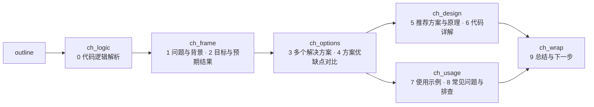

# learn_loop：读完代码后如何写出学习文档

> 依据（均已读过源码/配置，未做端到端实跑）：
> `config/workflows/learn_loop.toml`、`config/workflows/doc_review_loop.toml`、
> `latte-agent-core/src/workflow.rs`（`assemble_draft_from_sections`、`run_learn_control_step`、
> `deterministic_grade_quiz`、`deterministic_learning_ask`）。
>
> 读法：先看 §1 的一句话与 §2 的全景图，再看 §3 的目录树（知道每个文件是谁写的），
> 然后按 §4 的步骤逐个看。§9 是一次完整的示例运行。§10 是已确认的缺陷。

## 1. 一句话

先由 **plan** 读代码、拆出 3–6 个知识点；再由 **doc_review** 让「总编写框架 → 多个 writer
一人一章并发写 → 审稿员对照源码挑错，不合格只让被点名的章重写」；文档由**引擎**拼成
`draft.md` 给学员读；学员答题，答错或有补充就带着反馈回到 doc_review 增强文档；最后 **merge** 定稿。

## 2. 全景图

```
                       ┌────────────────────── QUIZ_FAIL ──────────────────────┐
                       │                                                       │
plan ─► annotate ─► doc_review ─► [引擎装配draft.md] ─► read_confirm ─► quiz ──┤
                       ▲                                (点「开始答题」) (弹窗答题)│ QUIZ_PASS
                       │                                                       ▼
                       └───────────── SUPPLEMENT ◄──────────────────────── supplement
                                                                               │ ALL_DONE
                                                                               ▼
                                                    merge ─► [sync_code 可选] ─► report
```

- `read_confirm`、`quiz` 由引擎确定性执行（弹窗、判分、写账本不走模型）。
- `doc_review` 是一个**嵌套 workflow**（`doc_review_loop`），不是单个模型步。

## 3. 产物目录：每个文件谁写、谁读

学习工作区在**会话目录**下：`.latte/sessions/<会话id>/learn/<slug>/`（模板变量 `{{learn_root}}/<slug>`；
没有会话 id 的独立 run 退回 `.latte/learn/<slug>/`）。学习过程的中间产物都只在这里，任务完成时由 merge
发布到项目的 `docs/learn/`。**工作区只属于创建它的会话，新会话不继承旧会话的内容**（旧返工单、旧章节、旧账本
都不带，每次从零写文档，不受以前写坏的内容影响）。内容只往一个方向流：会话 → 它启动的子会话（嵌套
workflow、fan_out 的章节 writer、delegate），子会话继承父会话的 `session_id` 与 `{{learn_root}}`，写进父会话的
那一份；断点续跑回到原来绑定的会话，用同一份工作区：

| 文件 | 谁写 | 谁读 | 作用 |
|---|---|---|---|
| `plan.json` | plan | annotate、outline、writer、proofread、quiz(引擎)、merge | 知识点、证据、例子、题目、答案、`doc_outline` |
| `ledger.json` | plan 初始化；quiz(引擎) 改判分；supplement 记补充 | read_confirm、quiz、supplement、merge、report | 只记事实：`round`、每点 `wrong`/`passed`、`supplements` |
| `code/<kid>-<文件名>` + `code/README.md` | annotate | outline/writer（引用）、merge、sync_code | 注释版代码副本（源码不动） |
| `sections/00_overview.md` | outline | writer（先读它对齐比喻）、引擎装配 | 全局比喻 + 全景链路 + 学习路径 |
| `index.md` | outline | proofread | 阅读入口与各章链接 |
| `feedback.md` | outline | 各 writer | 本轮是全量重写还是局部修补，及按章分组的意见 |
| `sections/<kid>.md` | 每个 writer 各写一个 | proofread、引擎装配 | 一个知识点一章正文 |
| `draft.md` | **引擎装配**（writer 不写） | 学员、merge | 学员阅读的整篇文档 |
| `img/ml-<hash>.svg` | **引擎渲染**（来自 ```memlayout 块） | 学员、merge | 内存布局图 |
| `docs/learn/<主题名>.md` + `docs/learn/<主题名>/` | merge（引擎） | — | 最终交付 + 它引用的章节/副本/图 |

`plan.json` 每个知识点的字段：`id`、`title`、`evidence`(file:line)、`teach_points`、`example`、
`doc_section`、`question`、`options`(4 项)、`answer`。`ledger.json`：`{round, knowledge_points:[{id,wrong,passed}], supplements, _graded_answers}`。

## 4. 步骤详解

### 步骤 1：plan —— 读代码，定「教什么」

- 角色 tutor；工具 `read`/`code_graph`/`search`/`write`，**没有 `ask`**（设计阶段不打扰学员）。
- 引擎要求：必须至少调过一次取证工具、必须 `write` 过（否则重试）。
- 做的事：
  1. 取证：`code_graph` 取签名和行号，`read` 精读，`search` 找宏/字符串。
  2. 拆 3–6 个互不重叠、由浅入深的知识点，第一个必须是「这东西是什么、整体怎么运转」。
  3. 写 `doc_outline`：第 1 节固定为「全局心智模型与贯穿比喻」；涉及分档/分类/分层，必须含
     「怎么存（物理视图）」与「为什么这样存（权衡与反向思考）」。
  4. 每点写 `example`（最小具体例子：传什么进去→出来什么）和一道考理解的四选一题
     （不许考「在第几行」这种查表题，禁 `recommended` 字段，正确项位置自己打乱）。
  5. 落盘 `plan.json`、`ledger.json`（`round:0`，每点 `wrong:0, passed:false`）。同 slug 重跑也必须刷新，不能跳过。
- 输出：**只输出 slug**（3–60 字符，禁空格、`/`、`\`、反引号），下游把它拼进路径（`{{plan_out}}`）。

### 步骤 2：annotate —— 生成注释版代码副本

- 工具只有 `read` + `write`，**没有 `edit`**，所以物理上改不到源文件。
- 按每个知识点的 `evidence` 读原文，逐字保留代码、只加面向零基础的中文注释，写到
  `code/<kid>-<文件名>`；同一文件被多点引用则合并；最后写 `code/README.md` 对照表。
- 作用：让 writer/学员写文档、读文档时有可对照的带讲解代码。

### 步骤 3：doc_review —— 写文档（核心，嵌套 `doc_review_loop`）

引擎把 `slug`、`draft`、`plan`、`ledger` 路径作为 topic 传入。内部分三个 wave：

```
wave0 outline ──► 章节分节写作 5 阶段 ×N（§3.2）──► wave2 proofread ──┐
    ▲                                                                  │
    └──────────────── NEEDS_FIX（最多 3 轮）◄──────────────────────────┘
                                          LOOKS_CLEAR → 返回外层
```

#### 3.1 outline：总编，只搭骨架，不写章节正文

按顺序写三个文件：
1. `sections/00_overview.md`：生活化比喻（把核心角色映射成实体）→ 端到端全景（一次典型操作从头到尾）→
   **学习路径**（每章要回答的**设计问题**，说明这章解决前一章留下的什么矛盾）→ 各章相对链接。
2. `index.md`：一句话主题 + 阅读顺序 + 各章链接与一句话摘要。
3. `feedback.md`：
   - prompt 末尾**没有**「【上轮审查反馈】」→ 写单行 `MODE: FULL`（首轮，全部重写）。
   - **有**反馈 → 写 `MODE: PATCH`，把审稿的每条 ISSUE 原文按章 id 分组抄进去：
     ```
     MODE: PATCH
     ## k3
     - ISSUE: k3 | BLOCKER | 事实错误 | …
     ## overview
     - ISSUE: overview | BLOCKER | …
     ```
     `## overview` 组代表全局意见：outline 当场改 `00_overview.md` 与 `index.md`。
   - outline **不许**自己改 `sections/k*.md`。

#### 3.2 章节分节写作：结构由引擎持有（6 个 fan_out 阶段）

一章固定 10 节（第 0 节 + 第 1-9 节），每节一个文件 `sections/<k_id>/<n>_<key>.md`。章节写作拆成 6 个阶段，
每个阶段都是按 `plan.json` 的 `knowledge_points` 每章派发一次的 fan_out step：



「先读代码、再讲从代码里看出的问题、再列方案、再对比、最后讲原理和代码」由流程保证，不靠 prompt：

| 机制 | 作用 |
|---|---|
| `write_path_allowlist` 只放行本阶段的节 | 写方案对比的阶段物理上写不了代码详解，不会把节挤在一起 |
| 第 0 节「代码逻辑解析」排在最前 | 读者先把 evidence 里的函数按执行顺序读一遍（控制流图 → 逐行中文注释 → 循环逐轮推演），末尾列出代码直接暴露的问题；第 1 节「问题与背景」必须从这些问题展开，不凭空设定 |
| 引擎注入 `{{chapter_so_far}}`（本章前面已写好的节） | 写对比时一定看得到方案，写代码时一定看得到对比结论 |
| 阶段结束逐节检查（`check_chapter_stage`），不过带原因重试 | 缺节；第 0/6 节代码块里带**中文**讲解的代码行占比 < 70%（源码自带英文注释不算、一句注释只盖紧随的一行）；第 0 节代码里有 `for`/`while`/`loop` 却缺「循环」小节（每个循环一节，最多要求 4 节）或缺 ≥2 行数据的逐轮推演表；第 0 节缺代码块 / 出处 / 控制流图；方案 < 2 个或没有草图；对比表 > 一半单元格是纯形容词；原理节没图；代码节没代码块或没 `file:line`；示例节没代码；FAQ < 2 条；mermaid 首行不是图类型 / 标签含特殊字符没加引号 / 引号不成对 |
| 装配时引擎写 `## 章名` + `### n. 节名`、按 1→9 拼接 | 节的顺序和标题不可能漂移；writer 自写的重复标题被剥掉；缺的节不出空标题 |

- 节检查重试用完按现稿放行并发 Status：一节不够好不值得让整章变成 `FAN_OUT_ITEM_FAILED`。
- 装配结果写回 `sections/<k_id>.md`，所以 index 链接、merge、旧的返工基线都照旧。
  没有分节目录的旧章节仍按整章文件装配。
- 返工（`MODE: PATCH` 且点名本章）：5 个阶段都只派发被点名的章；已有的节抓基线，
  改坏（删出处 / 篇幅缩到六成以下）就还原并重试；与意见无关的阶段回 `UNCHANGED`。
  旧章节没有分节目录时，返工按首写处理——借返工迁移到 9 节结构。
- 素材来源：plan 步的每个决策必须带 `pain`（直觉做法在带具体输入的场景里哪一步出事），整个 design 带 `hook`（开篇例子）。
  **替代方案可以为空**；写了就必须带 `basis`（引擎核对 `file:line` 真实存在），有真实替代方案时才要求
  `scenario` / `dimensions` / `chosen_walkthrough` / 各方案 `walkthrough` / 至少一个 `wins_when`，
  由 `check_learn_plan_design` 机械校验。第 3、4 节照着它们展开；没有替代方案的决策，这两节引擎直接省掉（见 §10）。
- 代价：每章模型调用从 1 次变成 5 次（每次范围更小、上下文更短），阶段之间有 wave 屏障。

**章节 writer 的提示词结构（为省 token）**：工具循环里每一轮请求都会把全部历史（含任务提示词）重传一遍，
所以提示词里的每一段都按「要重传几十次」来算账：

| 做法 | 原因 |
|---|---|
| 静态规则在前（角色、节规格、通用纪律、总览 `{{overview_text}}`），逐章变量在后（「本次任务」：契约、本章文件、`{{chapter_so_far}}`、`{{item_brief}}`、`{{item_sources}}`、`{{item_feedback}}`） | 缓存按前缀匹配；前缀里一出现 `{{item_id}}`，后面所有章 / 阶段共有的规则文本就没法共享缓存。有单测保证静态前缀里没有逐章变量 |
| 引擎注入本章的知识点、它依据的决策、全局设计（`item_brief`），不让 writer `read` 整份 `plan.json` | 整份 1.4~2.1 万字符，只有约 2.5KB 是自己要用的，读完还会留在上下文里被重传 |
| 引擎把 `evidence` 区间读出来带行号注入（`item_sources`，合并重叠区间、≤1.6 万字符、不读项目外路径） | writer 每章都要先读这些区间，引擎早就知道是哪几段 |
| 引擎注入本章的返工模式与意见（`item_feedback`） | 省掉每个子会话为 `feedback.md` 多出的一轮往返 |
| `chapter_so_far` 超过 1.4 万字符就把最长的节换成摘要（头 500 字 + 尾 900 字 + 子标题 + 全文路径） | 否则 `ch_wrap` 这种只写 1~2KB 的小节，提示词也有 6 万字符；尾部必须保留（第 0 节末尾是下一章要展开的「直接问题」） |
| 提示词里写明「写完不要回读自己刚写的文件」 | 实测写作子会话的 `read` 多半是在回读自己刚写的节；引擎会逐节检查并把问题带回 |
| annotate 步由引擎把每个副本的带行号全文和知识点要点注入（`annotate_brief`），辅导员只用行号 + `expect` 批量 edit 行尾注释 | 实测 annotate 曾是单个子会话 51 次调用、145 万输入 token（边读边改，历史越传越大） |

用 `latte-agent debug usage <会话id>` 看每一步的输入 / 输出 / 缓存命中 / 放大倍数，优化前后用它对比。

## 引擎对文档里「事实」的机械核对

写手靠心算数行号、凭印象写数字，这两类错误模型自己查不出来（实测 jemalloc 会话 ui-75536：16 块带行号摘录里 6 块行号错位；
`SC_NBINS` 在文档里同时是 36 和 39，小白试学 5 章没发现）。引擎对能机械判定的部分自己查、自己改：

| 核对 | 位置 | 处理 |
|---|---|---|
| 正文「`符号`（`文件:行号`）」对不上源码 | `learn_cite::check_text`，每个章节阶段写完 + 试学前 | 能确定的引擎直接改行号，有多处定义的打回 |
| 代码块里 `N: 代码` 的摘录行号 | 同上（`fix_numbered_excerpts`） | 块头能解析出文件时，逐行在 ±8 行内按内容定位，错位的改成真实行号并同步块头的起止；写手加的注释行跟随邻行；内容根本不是源码（一半以上找不到、至少 3 行）判错打回 |
| 同一个宏在不同地方写成不同的数 | `learn_facts::conflicts`，试学前（`novice_numeric_issues`） | 作为引擎提出的问题交给辅导员（多数派在前，一样多则两边都可疑）；辅导员回 FIXED 后引擎重扫，矛盾还在就不认，打回重做 |

| 「算式 = 结果」不成立 | `learn_arith::scan`，试学前 | 引擎自己把算式抠出来算（`4 * (62 - 6 + 1) - 1 = 228`、百分数、LaTeX、上标）；含变量 / 单位 / 位运算的不判；不成立的交给辅导员重算 |
| 带出处的断言与源码原文不符 | `learn_claims` + `learn_fact_check`，试学前 | **取证由引擎做，判断才交给模型**：每条「含数字或代码片段、带 `文件:行号`」的正文行，引擎把它引的源码（带行号，前后各扩几行）配在旁边，分批做**无工具、无历史**的模型调用，只回答「证据是否直接推翻这句话」；判错必须附 `source_quote`，引擎核对它**逐字**在证据里，核不上的判决丢弃；通过的变成引擎提出的问题。同一条断言（原文 + 证据没变）缓存，返工只核改过的；辅导员 WONTFIX 的不再核 |

为什么不只靠小白：小白要自己找文件、读、对照，读完 5 章可以提出 0 个问题（`ui-75536` 里有 `batch_alloc` 被说成 fast path、`ausize` 写成 `usize` 这类错）。
证据就在引用的那几行里，取证这一步不该压在一个工具循环的 agent 身上。推理型模型回答前要想很久，一批太大会把输出额度花在思考上、content 为空，
所以批小（约 12K 字符）、并发 3，失败的批对半拆开再问。

数值核对只看正文里的「大写宏名 = 数字」，不看代码块；宏名必须带下划线；数字后紧跟运算符是算式不算；`16 KB` 与 `16384` 归一；
整行带「若 / 假设 / 改成 / 推测 / arm」等条件措辞的不算；「⚠️ 待确认」注记不算。引擎不判哪个数对，只指出矛盾。

矛盾的源头通常是 plan 阶段的 `example`：plan 没有逐行推导，却被要求给「最小具体例子」，模型就编数字，后面每一章照抄。
所以 plan 提示词要求「数字只写能从证据里直接抄到的」，章节提示词和 `item_brief` 里也写明 plan 里的数值未核实、以自己的推导为准。


#### 3.3 proofread：审稿员，只读不改，对照源码核查

- 工具 `read`/`search`/`code_graph`/`doc_graph_context`，必须至少 `read` 一次。
- 顺序：`index.md` → `00_overview.md` → 各章；**每章至少核对 2 处**关键代码/数值与源码一致。
- 也会拿到 `{{chapters_out}}`（各 writer 汇总产出），含 `FAN_OUT_ITEM_FAILED` 或章文件缺失 → 该章缺章 = BLOCKER。
- 分级：

  | 级别 | 内容 | 是否触发返工 |
  |---|---|---|
  | BLOCKER | 事实错误（须亲自读源码确认）；伪代码冒充源码；没讲清设计动机/备选/好处坏处；把猜测写成事实；章序跳跃、前后重复矛盾、只罗列代码；缺章 | 是 |
  | NIT | 措辞、图表偏密、术语铺垫、行号小偏差、排版 | 否 |

- 输出格式：`ISSUE: <k_id 或 overview> | <BLOCKER/NIT> | <类别> | <具体问题> | <应补内容>`；
  章 id 必须写准（返工靠它分派给对应 writer）。
- 最后一行：有任一 BLOCKER → `NEEDS_FIX`，否则 `LOOKS_CLEAR`；除末行外不许出现这两个词。
- 循环参数：`loop_until=LOOKS_CLEAR`，`loop_back_to=outline`，`max_iterations=3`；
  `prompt_token_ratio=0.8`，上下文溢出自动全新重启（最多 2 次，重启时保留 `index.md`）。

#### 3.4 返工一轮到底怎么走（NEEDS_FIX）

1. proofread 输出 `NEEDS_FIX` + ISSUE 列表；
2. 引擎跳回 outline，把 ISSUE 列表作为「【上轮审查反馈】」拼到 outline 的 topic 末尾；
3. outline 见到反馈 → 写 `MODE: PATCH` + 按章分组的 `feedback.md`；
4. 引擎再次 fan_out：被点名的章 writer 只改意见涉及处，其余章输出 `UNCHANGED`；
5. proofread 重审；第 3 轮仍不过则停止循环（保险丝）。

### 步骤 4：引擎装配 draft.md（零模型调用）

`assemble_draft_from_sections`，在 read_confirm 与 quiz 执行前调用：

1. `sections/` 或 `plan.json` 不存在 → 不装配（返回 false）；
2. 若 `plan.json` 有 `design.decisions`，引擎先写入「核心结论与设计决策」
   （一句话结论 + 决策总览表），不依赖 outline 手写；没有 `design` 时跳过，旧文档装配不变；
3. 再拼 `00_overview.md`，然后按知识点顺序逐章；
4. 找章文件：先 `<id>.md`，找不到再匹配 `<id>_*`、`*_<id>`；空文件跳过；
5. 装配时剥掉符号索引 mermaid（节点多数是 `fn xxx` / `struct xxx`），数据流图保留；
6. 各段之间以 `\n\n---\n\n` 分隔，整体覆盖写 `draft.md`；全空则不写。
7. **相对链接改基准**：节文件在 `sections/<id>/`、章与总览在 `sections/`，各自写的相对链接（`k2.md`、
   `../00_overview.md`）拼进上层文件时改写成相对新位置（`draft.md` 里是 `sections/k2.md`）。节里的章节互链
   按约定写 `k2.md`，在节目录下找不到时按 `sections/` 兜底解析。代码块、行内代码、URL、锚点不动。
   此前不改写：draft 里的 `[k1](k1.md)` 指向不存在的 `<slug>/k1.md`，大窗里点开 404。
8. **memlayout → SVG**：```memlayout 块（`lane` / `cell` / `gap` / `ptr` 四种指令）渲染成
   `img/ml-<源码哈希>.svg`，正文换成图片链接；节文件里保留源码，返工改的仍是文本。写作阶段
   `check_chapter_part` 先校验语法（错误带行号打回），并把它算作「图」。写作期另查**偏移连续性**：`@偏移` 必须等于前面各格大小之和
   （跳过的字节要写成 `gap`，重叠说明大小算错）；渲染时不拦，已写好的图照常出 SVG。
   另查**图自己的声明**（`memlayout_claim_problems`）：行说明里的 `= N KiB` 必须等于这一行格子之和，
   标题里的 `= N KiB` 至少等于某一行的总长；数据格（used/free/data）和元数据格（meta）画在同一行、
   行说明里又没有 `file:line` 出处时打回（这是在断言「元数据内嵌在数据区里」，最容易画错）。
   `outline` 步写的 `00_overview.md` 也走同一套检查（只在本步改动过文件时查）。
   装配后清掉不再被引用的 `img/ml-*.svg`。

### 步骤 5：read_confirm —— 等学员读完（引擎）

- 弹一个只有一项「开始答题，验证掌握程度」的窗口，窗口里直接渲染 `draft.md` 内容；
- 题面：`学习材料（第 {round+1} 版）：<learn_root>/<slug>/draft.md。读完了吗？`；
- 卡片里的文档按 `document_path` 所在目录解析相对链接；「大窗查看」里点嵌套 md 在同一窗口打开，带「← 返回」；
  `/api/doc`、`/api/doc-asset` 放行 `.latte/sessions/<sid>/learn/` 子树（会话目录其它内容不暴露）；
- 引擎先查 `AnswerLog.recall(题面)`：**题面文本相同则直接回放上次答案，不弹窗**。

### 步骤 6：quiz —— 判分（引擎，确定性）

1. 从 ledger 取所有 `passed == false` 的知识点，从 plan 取对应题目；
2. 一次 `questions=[...]` 弹全部题，每题题面追加 `［第{wrong+1}次作答］`（避免题面重复被回放）；
3. 判分：按 **label 文本**比对，与选项位置无关；归一化（去首尾空白/收尾标点/忽略大小写）后
   相等，或互相包含（正确 label ≥2 字才允许包含）即对；乱填、空、自由文本按错；
4. 改账本：答对 `passed=true`；答错 `wrong+1`；用 `_graded_answers` 的 `id:attempt` 做回执，重放不重复计数；
5. 输出：逐题「判分结果 / 你选的是」；答错题附正确答案、一句「为什么」（该点 `teach_points` 首条）、
   `file:line`，并列出该点 `requires` 里仍未掌握的前置；末行 `QUIZ_PASS`（全对）或 `QUIZ_FAIL`。
6. `QUIZ_FAIL` → 引擎跳回 `doc_review`，这段判分文本整体成为「【上轮审查反馈】」，
   即 outline 会把它当作章级意见，走 3.4 的 PATCH 路径，让答错点对应的章增强「易错点辨析」。
7. `max_iterations=10` 为保险丝，不设「错几次放弃」。

### 步骤 7：supplement —— 全对后收集补充（模型步）

- 一个只有「没有了，全部理解」的窗口；想补充的学员走自动附带的「其他（自定义）」输入；
- 题面必须带轮次号（防回放）；
- `没有了` → 写一次 ledger（仅刷新 `updated_at`）→ 末行 `ALL_DONE`；
- `其他：<内容>` → 把原文追加进 `ledger.supplements`（`{round, asked}`）→ 末行 `SUPPLEMENT`，
  引擎跳回 `doc_review`，补充内容作为反馈让 outline 分派。

### 步骤 8：merge、sync_code、report

- **merge**（引擎确定性，不调模型）：`finalize_learn_doc` 把装配好的 draft 加标题、目录，有注释副本则文末附索引；
  定稿名 = slug 去掉看板任务编号（`lat-110-jemalloc-size-class` → `jemalloc-size-class`），写
  `docs/learn/<主题名>.md`；定稿引用的文件**及其传递闭包**（章节 md 里再链到的章/图/副本）拷到
  `docs/learn/<主题名>/`（目录带 `.latte-learn-assets` 标记，每次定稿整体重建），链接改指那里——
  定稿不依赖会话目录。只拷闭包不拷整目录：同一会话内重新 plan 后，`sections/` 里仍可能留着旧 plan 的章
  （实测 LAT-110：plan 从 7 点变 4 点后 k5–k7、appendix 还在）。
  写完按出处/图数/篇幅自检。
  早先由模型整篇重写；9 节结构下实测 4 章 draft 191KB，一次 write 远超模型输出上限。
- **sync_code**（可选，主题含「同步注释」/「写进源码」才跑）：`edit` 把注释写进真实源码，
  只改注释、以代码原文为锚点，找不到锚点就跳过并说明。会修改仓库，建议开 isolated worktree。
- **report**（只读）：输出掌握进度 X/Y、答错次数、补充清单、交付路径。

## 5. 硬约束速查（都是引擎字段，不是 prompt 劝告）

| 想防止的问题 | 机制 |
|---|---|
| writer 覆盖别人的章 | `write_path_allowlist` |
| 一章失败拖垮全篇 | `fan_out.tolerate_failures` + 审稿判缺章 |
| 模型凭记忆写文档 | plan/writer 必须读源码；审稿每章核对 2 处 |
| 伪代码冒充源码 | writer 标准 + proofread BLOCKER |
| 文档顺序漂移/丢内容 | 引擎按 plan 顺序装配 |
| annotate 改到源码 | 无 `edit` 工具 |
| 返工范围失控 | `feedback.md` 按章分组 + `UNCHANGED` |
| 审稿无限循环 | `max_iterations=3`；外层 quiz/supplement 各 10 |
| 上下文爆掉 | `prompt_token_ratio` + 自动重启 |
| 图与自己的说明/格子对不上 | `memlayout_claim_problems`（声明总数对账、内嵌元数据要出处），章节各节与总览都查 |

## 6. 一次完整示例（3 个知识点 k1/k2/k3）

1. plan 写出 3 点，`ledger.round=0`；输出 slug `demo`。
2. annotate 生成 `code/k1-*.rs` 等副本。
3. doc_review 第 1 轮：outline 写 overview/index、`MODE: FULL`；3 个 writer 并发写 `k1.md`/`k2.md`/`k3.md`；
   proofread 报 `ISSUE: k2 | BLOCKER | 事实错误 …` → `NEEDS_FIX`。
4. 第 2 轮：outline 写 `MODE: PATCH` + `## k2`；k1、k3 writer 输出 `UNCHANGED`，只重写 k2；proofread `LOOKS_CLEAR`。
5. 引擎拼出 `draft.md`；read_confirm 弹「第 1 版」，学员读完点击。
6. quiz：k1 对、k2 错、k3 对 → 账本 `k2.wrong=1`，`QUIZ_FAIL`，判分文本回到 outline。
7. doc_review：outline `PATCH` + `## k2`（来自判分反馈）→ 只重写 k2 加易错点辨析 → 再拼 draft.md。
8. read_confirm → quiz（只考 k2，题面 `［第2次作答］`）→ `QUIZ_PASS`。
9. supplement：学员输入「想了解锁竞争」→ `SUPPLEMENT` → 回 doc_review 补内容 → 再答 → `ALL_DONE`。
10. merge 定稿，report 输出 3/3。

## 7. 前置条件与失败处理小结

- 任何一步 `require_tools`/`output_contract` 不满足，引擎按 `max_retries` 重试，再失败则 workflow 失败；
- `plan.json` 或 `ledger.json` 缺失，`run_learn_control_step` 直接返回错误；
- 引擎不会阻止你手改 `draft.md`，但下次装配会被 `sections/` 覆盖——要改请改章文件。

## 8. 与旧设计文档的差异

`docs/learn-loop-doc-driven-design.md` §5 的表格与 §5.2（`doc` 单步、`loop_back_routes = doc`）
已过期，现行为 `doc_review` 嵌套 workflow；该文档未同步。

## 9. 缺陷与修复记录

1. **`ledger.round` 从不自增（已修复）**。原因：设计文档里「doc 步 round+1」随 doc→doc_review
   迁移丢失，全仓只有 `read_confirm` 读它。后果：返工后 `read_confirm` 题面仍是 `第 1 版`，
   `AnswerLog::recall`（`workflow.rs` `deterministic_learning_ask`）静默回放旧答案、不弹窗。
   修复：引擎函数 `bump_learn_round`，在 learn_loop 的 quiz（QUIZ_FAIL）/ supplement（SUPPLEMENT）
   触发 `Rework` 跳回 `doc_review` 时自增 `ledger.round` 并写盘（两处 `SerialLoopNav::Rework` 分支）。
   验证：单测 `bump_learn_round_increments_persisted_round`；`quiz_fail_reworks_to_doc_then_pass_advances` 仍通过。
   未做端到端实跑。
2. **quiz 判分反馈没有专属的章 id 分组（已修复）**。原先反馈是自由文本，outline 要自己拆出 `## k2`，
   拆错会让该增强的章被 `UNCHANGED` 跳过。修复：`format_quiz_feedback` 在有答错时追加
   「【按章分组的返工意见】」块（引擎确定性生成，只含答错的章，格式 `## <k_id>\n- …`），
   `doc_review_loop` 的 outline prompt 要求把该块原样抄进 `feedback.md`。
   验证：单测 `quiz_feedback_groups_wrong_points_by_chapter_id`；未做端到端实跑。
   残余风险：抄录仍由 outline 模型执行，只是不再需要它判断章 id。
3. **方案对比讲不透、原理与代码挤在一起（已改为流程约束）**。单个 write_chapter 一次写整章时，
   prompt 里列的 7 段要求在产出里退化：对比表全是「灾难级 / 极低 / 极佳」，配了编造的性能数字
   （「暴跌至单核的 10%」），全景图的 mermaid 标签 `arena->bins[bin_ind]` 没加引号、页面渲染失败
   （实测 jemalloc `lat-111-jemalloc-arena`）。修复见 §3.2：拆成 5 个阶段 × 9 节、引擎持有结构与检查。
   验证：对该实测文档跑新检查，overview 报出 5 处未加引号标签，k1-k4 均报缺方案对比各节、0 张图；
   单测 `chapter_part_checks_are_mechanical_per_section` 等。未做端到端实跑。
4. **端到端实跑（2026-10-02，主题 choice.rs resolve/resolve_one，glm-5.3）暴露的问题（已修复）**：
   - plan 被打回后**整轮重新取证**（单次 ~9 分钟）：批注改为「plan.json 保留原处，只改点名字段」；
   - evidence 写成 `src/choice.rs:255-317, 606-608`，续写段被判格式错误：续写行号沿用前一个文件（`split_learn_evidence`）；
   - 重试时模型在 slug 前加一句说明，被 60 字符契约打回又白跑一轮：取末行 slug（`trailing_slug`）；
   - 对比深度（wins_when 等）卡死 plan 的风险：重试用完时只放行深度项，证据/题目错误仍判死；
   - merge 让模型重写 191KB 定稿必然截断：改为引擎定稿；
   - 总览小节与章名同为 `##`，定稿目录混排：总览挂到「全局总览」下并降级。
   实测结果：4 章 × 9 节全部按序装配，逐节检查一次通过（无重试），22 张 mermaid 全部通过 mermaid.parse；
   对比表单元格为具体值。耗时：plan 18 分钟（3 次尝试）、annotate 2.5 分钟、文档 5 阶段 28 分钟。
5. **图文不一致：总览里的内存布局图多画了一块不存在的内嵌头部（已加机械对账，语义层仍有缺口）**。
   实测 jemalloc `lat-110`：总览的 slab 图画成「1 KiB 位图元数据头 + 14 KiB 槽 0 + 14 KiB 槽 1」（共 29696 B），
   而行说明写「7 个 4KB 页 = 28 KiB」，各章里同主题的图也是 28672 B、无头部。源码事实：
   `arena_slab_reg_alloc` 用 `edata_addr_get(slab) + reg_size * regind` 算地址（`src/arena.c:235-237`），
   位图在带外的 `edata_t.e_slab_data`（`edata.h:246`），slab 数据页就是 `nregs × reg_size` 一整块。
   漏网原因：(a) `outline` 步没有任何质量门，总览里的图连语法都没被 lint；(b) 现有检查只看语法和 `@偏移` 连续，
   这张图格子自己加起来是连续的；(c) 总览先于各章写成，之后没有环节回头核对图与图、图与文；(d) 审稿步已移除，
   没有任何环节拿图去对源码。
   修复：`memlayout_claim_problems`（声明总数对账 + 内嵌元数据要 `file:line`）接入 `lint_memlayout_blocks`，
   章节各节与 `outline` 写的总览都走它；writer prompt 要求画之前读源码核实地址/偏移怎么算。
   验证：对该工作区的 8 个真实 memlayout 块跑新检查，只命中总览那 1 个（命中原因：声明 28672 B、格子 29696 B），
   其余 7 个零误报；单测 `memlayout_claims_*`、`overview_figures_are_linted_with_claim_check`。未做端到端实跑。
   **残余缺口（机械检查做不到的）**：声明与格子自洽、又给了一个看似合理的 `file:line`，但结构本身画错，
   仍会漏过去——出处只做格式检查，不核对内容；图与正文其它位置的数值（如 232 vs 235、4096 vs 8192）互相矛盾也不查。
   补这一层需要独立于 writer 的「图文核对」审稿（拿图里每个 cell/ptr 对源码），代价是重新引入一个会拖慢学员的环节，见讨论。

## 10. 读不懂、写太多：流程层的根因与修复（2026-10-22）

实测 LAT-100（RocksDB 的 Slice / Status / Comparator，三个头文件共约 1000 行）：草稿 509KB，每个知识点 80~127KB；
开篇直接是「作者选了什么、放弃了什么」，读者连要解决什么都没见过；试学题自己有错。以前的修法都在改结果文档，
下面是流程里的 5 个根因，以及各自改了什么。

| # | 根因（流程层） | 机制 | 改动 |
|---|---|---|---|
| 1 | plan 门禁**强制**每个决策 ≥1 个替代方案，并要求 walkthrough / `wins_when` | 模型没得选，只能编（Slice 的 SSO、shared_ptr 在仓库里没有痕迹），对比表里全是 `[推测]` | `alternatives` 可空；写了必须带 `basis`，引擎核对行号存在；有真实替代方案才要求对比推演素材 |
| 2 | 读者模型是「作者的取舍记录」：总览首屏是引擎生成的「一句话结论 + 决策表」，每章第 0 节是逐行读代码，「问题」要到第 1 节才从代码里「看出来」 | 读者看到答案时还不知道问题 | plan 必填 `design.hook` / 决策 `pain`；总览首屏改为「先看一个例子」；第 0 节必须以 `#### 先看问题` 开篇（`check_opens_with_problem`，排在第一张图之前） |
| 3 | 每个知识点一律写满 10 节，知识点数硬要求 3~6 个 | 篇幅跟模板走，不跟复杂度走；第 0 节与第 6 节是同一段代码讲两遍 | plan 的知识点数随证据体量（< 150 行 1~2 个）；`skip_parts`（可省 2/3/4/6/7/8，0/1/5/9 必写）；决策无替代方案时引擎自动省 3、4，对应阶段整章不派 writer，旧稿删除；`learn_plan` 的章体量按锚点行数估 |
| 4 | 试学题由 plan 的同一次生成写出，强制「至少一道题带 如果/换成/为什么」；标准答案没有第二个人核对；复查还强迫小白答成标准答案 | 出现「换成 std::string 会多付出什么」这类题，标准答案是模型想象的，小白答对了反而被判错，文档被往错的方向改（n26） | 删掉关键词硬性要求；每题必填 `answer_basis`；问「换成 X」的题，X 必须是带出处的替代方案；quiz 类问题的措辞不再预设小白错；`novice_fix` 可改 plan.json 里的题（事实校验失败则还原），复查按 plan 当前答案判（`quiz:<id>` 记在 issue 上，不靠题面文字） |
| 5 | 唯一的「读得懂吗」审查者是小白，但它的指令只有核对事实；机械核对把行号差一当错误（22 条待处理里 13 条） | 循环的预算花在不影响理解的事上 | `prompts/novice.md` 加三条读者体验检查（开篇有无例子、替代方案有无出处、篇幅是否匹配）；事实核对员与 `novice_fix` 提示明确：行号漂移 ±2 不算内容错误 |

读者底线（`hook` / `pain` / `answer_basis`）属于 reader 层：前几次尝试都打回重做，只有重试用完才放行（`validate_learn_plan_levels`）；
对比深度（`wins_when` 等）仍是「直接放行不重试」。

**验证**：新增单测覆盖——无替代方案可通过、无 `basis` / 假 `basis` 被拒、`hook` / `pain` 缺失或抽象被拒且末次可放行、
「换成 X」题无依据被拒、`skip_parts` 解析与自动省略、省略的节不作为检查对象且旧稿被删、第 0 节开篇检查、
设计总览以 hook 开头且无替代方案时不出「放弃的方案」列、复查按更新后的答案判。**未做端到端实跑。**
`learn_loop_engine_tests` 里 20 个需要模型解析的用例在当前工作区失败（`no model for role 'tutor' … 不启用 catalog 兜底`），
其中抽查的 6 个（含 `controller` 里两个与学习无关的用例）在 HEAD 通过；失败发生在模型解析，早于本次改动涉及的逻辑。
推测原因是工作区里未提交的 `model_resolver.rs` / `global_config.rs` 改动（未逐一验证）。

### 10.1 怎么区分问题的难易：体量得分（`learn_complexity.rs`）

“简单的问题少写”需要一把能复算的尺子，不能让写文档的模型自己觉得。引擎用 `evidence` 指向的源码量：

`得分 = 代码行数（不含空行、纯注释行） + 8×分支数 + 15×(文件数−1) + 30×有出处的替代方案数`

分支数 = `if` `for` `while` `switch` `case` `catch` `match` `loop` `?` `&&` `||` 的个数（按词边界数）。

| 档 | 得分 | 写哪几节 | 每节字数上限（字符） |
|---|---|---|---|
| 简单 | < 120 | 0 先看问题+读代码、1 问题与背景、5 原理、9 总结 | 4500 / 1500 / 2500 / 600 |
| 中等 | 120~300 | 简单档 + 3、4（有替代方案时）、7、8；不写 2、6 | 0:8000 1:2500 5:4000 7:2500 8:2500 3:3500 4:3000 9:800 |
| 复杂 | ≥ 300 | 全写（3、4 仍要有替代方案） | 0:12000 1:4000 2:3000 3:5000 4:4500 5:6000 6:6500 7:4000 8:3500 9:1200 |

- **档位由引擎算，plan 的模型改不了**；`skip_parts` 只能在档位之上再多省。读不到源码时不按档位省。
- **字数上限**写进 `PartTarget.cap`，首写的节超过就带原因打回，重试用完按现稿放行；返工增补不查。上限和体量说明通过 `{{item_skip_note}}` 注入每个阶段的提示词。
- **知识点个数**：全部点的得分之和每 200 分撑一个点（至少 1、最多 6），多了在 plan 校验里打回要求合并（reader 层，末次可放行）。
- **标定**：用 LAT-100 的 plan 证据复算——k1 `Slice` 35 行/8 分支=99（简单）、k2 拼接 25 行=72（简单）、k3 `Status` 113 行=200（中等）、k4 151、k5 156（中等），合计 678，撑得起 3 个点而不是 5 个。
  当时 k1、k2 各写了 88KB、81KB，与 k3 的 107KB 几乎一样大。阈值和上限是按这一组数据定的起点，不是理论值，积累更多主题后需要再标定。
- **没有量的东西**：分支数只是控制流复杂度的代理，没有量并发、unsafe、宏展开这类“代码不长但很难”的东西；这类主题会被低估成简单档。目前的办法是 `skip_parts` 之外没有手动上调档位的口子——需要时在 `learn_complexity.rs` 加权重。

## 11. 书目录的拆分：先主干后枝叶 + 第一性原理（`learn_plan`）

两条学习原则落到流程里：

| 原则 | 以前 | 现在 |
|---|---|---|
| 先抓主干，再填细节 | 提示里只说“自顶向下、主干优先”，没有机制。实测目录第 1 章是 Slice/Status/Comparator，宏观架构排第 3 章 | 每章必须标且只标一个层级：`层-树干`（1~3 章）/ `层-枝干` / `层-树叶`；清单顺序层级只升不降，由 `check_learn_book_output` 数 |
| 回归本质（第一性原理） | 没有 | 树干里必须有一章“推导章”：从 3~5 个最基础的事实（带数字）一步步推出系统必须长成什么样；枝干章开头要回指它是推导里的哪个环节。引擎检查树干章标题 / 描述含“推导”或“第一性” |

`tasks_json` 步新增 `require_learn_book = true`，引擎在清单落地时额外校验：
层级标签齐全且顺序先主干后枝叶；树干 1~3 章且有推导章；单个锚点文件 > 3000 行代码、一章合计 > 6000 行、非树干章 < 100 行都打回；
只锚定 `.h` 头文件、但验收要求读出行为（描述里没有“接口 / 契约 / 声明 / 配置 / API”）的章打回。体量只对 `learn_loop` 精读章量。
树干章用 `learn`（泛读讲解），不要求锚点文件。终审清单加了“先主干后枝叶”“伪依赖”。

**用现有 RocksDB 书目录试跑**（给每章补上枝干标签后）：引擎指出第 6、7、8、10、12 章只锚头文件、第 9 章过薄（240 行）、
第 11 章把 4731 行的 `db_impl.cc` 整个当锚点——和人工审查的结论一致。
没有量的东西：树干 / 枝干 / 树叶的归类和“推导章是否真在推导”仍靠模型和终审判断，引擎只检查标签、顺序和关键词；
体量用整文件算，是上限，不能区分“只读其中几个函数”的章。**未做端到端实跑。**

### 11.1 实测迭代记录（RocksDB，同一 topic，2026-10-23，8 次 chat 实跑）

| 发现 | 改动 |
|---|---|
| 初稿 27K 字符被截断 | 提示加篇幅硬约束；breakdown 加 `max_chars = 16000` 产出契约 |
| 清单上限写“12-20 章”，模型把章合并压缩（事务、观测、动手验证挤进一章） | 改为“章数以目录为准，≤ 36”；校验上限 40 |
| 清单一次输出放不下 36~50 章（22K 字符处截断） | 描述字数上限（硬 170）、空字段不写、章数上限 |
| 终审清单“环境章排最前”与“树叶排最后”互相冲突，环境章被驳回 | 新增 `层-地基`（0~2 章，先跑起来、会用 API，排在树干前） |
| 模型把所有 paths 留空，体量 / 头文件检查全被绕过 | learn_loop 精读章必须有 paths；提示要求逐个 `ls` / `search` 核实（类名 ≠ 文件名） |
| 薄章下限 250 行，把“乐观事务（204 行）”这种独立机制挡掉 | 下限降到 100 行 |
| `fenced_code_blocks` 在输出被截断于 ```json 时越界 panic，带崩整个会话（历史遗留 bug） | 切片前钳位，加单测 |
| `latte-agent-ui-server` 手写构造 `WorkflowStepDef`，新增字段后整个工作区编译失败 | 补字段 |

最后一次通过引擎结构校验的目录：34 章 = 地基 2 + 树干 3（推导 / 全景 / 端到端）+ 枝干 19 + 树叶 10；所有精读章都有 paths，体量 191~3056 行；
事务拆成乐观 / 悲观 / 两阶段 3 章。终审仍有内容级意见（正文与清单锚点口径不一致、两处章间复读、一处伪依赖、`version_set.cc` 行数低估 3 倍），
属于模型审出来的，引擎的数数检查拦不到。

### 11.2 第二轮实测（RocksDB，同一 topic，另 6 次 chat 实跑）

| 发现 | 改动 |
|---|---|
| tasks_json 步一边 `ls`/`search` 核实路径、一边把思考写进正文（`<think>` 泄漏），输出预算耗光，JSON 没出来就被截断，连续 3 轮整条重来（每轮 30 分钟以上） | 路径核实挪到 breakdown：目录末尾必须附“已核实锚点表（路径 \| 非空行数）”，tasks_json 只许从表里取 paths；该步工具收紧为 `read`（≤6 次），提示写明“纯转换，不要输出思考”。改后 tasks_json 一次通过，耗时 5 分钟（之前 20 分钟以上且常失败） |
| `<think>…</think>` 里的草稿 JSON 被当成“多份清单” | `find_tasks_fence` 先对闭合的 think 块等长遮蔽（按字节保持偏移，中文占 3 字节） |
| 清单和目录两套编号、顺序，终审无从对照 | tasks_json 提示：章号、标题、顺序必须与目录完全一致，不许重排合并；树干章（`learn`）允许无 paths，终审清单同步 |
| 终审反复指出“验收里的机制在本章锚点里找不到定义”（悲观事务缺 `TryLock` 所在文件、版本管理缺 `version_set.cc`、`db_bench.cc` 只有 21 行的壳） | breakdown 提示：验收里出现的每个关键机制，锚点里必须有定义它的文件（先 `search` 定义位置）；工厂 / 壳文件不算实现 |
| 描述字数硬上限 170 把正常的章反复打回（183、173 字），实际是在消耗重试次数 | 硬上限放宽到 260（提示里仍写“尽量 ≤ 100”）；真正防截断靠章数上限 + 空字段不写 + 纯转换 |

这一轮最后一次通过引擎校验的清单：29 章 = 地基 2 + 树干 3 + 枝干 21 + 树叶 3，精读章全带已核实路径（体量 249~3069 行），事务 4 章（全景 / 悲观 / 乐观 / 两阶段）。
终审（模型）仍在逐轮挑内容问题：验收与锚点错位、先修链互锁（第 18 ⇄ 21 章）、章内混了两个独立子系统（写队列与写停顿）、缺合并算子。
这类问题要靠多轮返工收敛，引擎只能保证结构、体量和锚点真实性，不能替终审判断“验收能不能从这些文件里读出来”。

### 11.3 输出长度上限：不再续写拼接，改为丢弃重来（借鉴 oh-my-pi / opencode / deepseek-harness）

对照三个项目后的结论：三家都没有“把截断输出续写拼接”这种机制。
oh-my-pi：撞 `length` 的轮次丢弃（模型看不到）、补一条“只推理下一步、大交付物先写最小版本”的提示、重试有上限，到顶报可操作的错误，工具调用的半截参数不执行；
opencode：封顶输出（默认 32K）、结构化数据走带 schema 的工具调用、计划是个文件而不是一次吐出的大文本；
deepseek-harness：`length` 作为结束原因交给上层，辅助调用超限直接报错，大编排用脚本把工作扇出给子代理再由代码聚合。

latte 的改动（`agent.rs`）：
- 默认行为：无工具调用的最终回复撞长度上限 → **丢弃这一轮**（不进上下文），补一条“已被丢弃、必须写得更短、不要输出思考/核对过程、大交付物分段落盘”的提示，最多重试 `LENGTH_DISCARD_MAX_RETRIES = 2` 次；到顶后带 `⚠️ [产出被截断]` 标记交给下游，由契约 / 步骤级重试接手。旧的续写拼接保留为 `LATTE_AGENT_LENGTH_RECOVERY=continue` 或 `AgentRunner::with_length_continuation(true)`。
- 泄漏的 `<think>…</think>` 在读取模型输出时就剥掉（闭合的整块去掉；截断时未闭合的思考整段丢弃），不占正文也不干扰后面的清单解析。

**实测发现真正的根因是配置**：`~/.latte/models.d/minimax.toml` 里 MiniMax-M3 的 `max_tokens = 8192`（注释写着“未实测，保守设”）。M3 是推理模型，思考 token 计入输出预算——
新逻辑第一次真实运行时日志是 `finish=length chars=0 output_tokens=8192`：8192 个 token 全花在思考上，可见正文 0 字符，重试同样耗光。
之前那些“续写到 5 段、13 万字符”的现象，其实是在续写思考过程。把 `max_tokens` 提到 32768（已改，原文件备份为 `minimax.toml.bak-20261024`）后，
整轮 learn_plan 没有再出现任何一次长度截断，tasks_json 一次通过。

没做的：让清单通过工具提交（schema 校验、分章提交）、推理循环检测（oh-my-pi 的 thinking-loop-redirect）。

## 12. 拆分收敛 + 写作侧缺口（2026-10-25）

### 12.1 learn_plan：终审一轮放行

终审每轮都在挑新的内容问题、标准越审越细，不收敛。两处改动：

- **能数的交给引擎**（`check_learn_book_output` / `check_learn_book_against_breakdown`，tasks_json 步）：depends_on 只能指向排在前面的真实章（倒置 / 环 / 不存在的标题都打回）；
  同一锚点文件最多 2 章精读（≥ 3 章打回，对症“跨章复读”）；清单的章号集合与每章标题要和目录文档对得上（标题按去掉章号与「回应事实N：」后的二元组重合度判断）。
- **终审只拦三类阻断**：B-覆盖（topic 点名的块一章都没有）、B-倒置（验收必需的知识只在后面讲）、B-实测（抽查到的 path / 符号确实不存在）。
  其余写成改进意见，由 gate 原样附在清单前交给精读阶段；裁决只有通过 / 不通过（去掉“有条件通过”，它曾和阻断项自相矛盾）；
  返工默认 `REWORK: tasks_json`（只改清单，便宜），整块缺失才回 breakdown。

实测 `wf-learn_plan-1792924680778389`：breakdown → tasks_json（引擎打回 1 次）→ verdict → gate，**45 分钟一次放行**，32 章（地基 2 / 树干 2 / 枝干 22 / 树叶 6），
附 8 条以上具体改进意见（第 13 章缺 `block_based_table_reader.h`、第 17 章点名 `LogAndApply`、第 15 章依赖的结构在第 17 章才讲等）。
放行后 manager 超出指令、委派 programmer 往 rocksdb 仓库写了一份未跟踪的 `docs/learn/rocksdb-code-map-learn-plan.md`，整会话 131 万输入 token——这是 manager 的问题，不在 learn_plan 里。

### 12.2 learn_loop 写作侧

- 缺 `design.hook` 时，引擎的开篇退回第一个决策的 `pain`；两者都没有时 outline 自己写「先看一个例子」。
- 被省略的节：装配时按 `skipped_chapter_parts` 过滤（磁盘上残留的旧稿、writer 越界写的都不装配），节号按实际装配顺序重排（0、1、2、3，而不是 0、1、5、9）；
  `chapter_so_far` 也不再注入被省略的节；每个阶段的提示里列出本章不存在的节，并要求引用别的节写节名、不写节号；`ch_design` 不再写死“达成第 2 节的目标”。
- 体量得分加 `25 × 难点行`（并发原语、unsafe / 裸指针转换、`#define`）：10 行的无锁 push 从简单档变为中等档。
- plan 校验：替代方案写了 `walkthrough` 就不再要求 `pros/cons`，且这项归对比深度；决策 `pain` “不够具体”归对比深度（只提示不重试）——
  实测这两项被放在不可放行的事实层，第 3 次 plan 尝试照样判死，整步 1 小时 56 分白跑。整篇的 `hook` 仍按读者底线要求具体。
- plan 步产出不是 slug（实测收尾只说了一句“几个行号差一，我再核对一下”）时，按学习目录推回 slug（钉死的直接用；只钉前缀的，目录下恰好一个带 plan.json 的才算）。

**LAT-100 实跑未完成**：续跑的第 2 次 plan 尝试中途，三个模型全部不可用——MiniMax-M3 返回 429（Token Plan 用量用尽）、glm-5.3 返回 401（key 无效）、
deepseek-v4-flash 返回 402（余额不足），`latte-agent test -m <model>` 逐个确认。所以 12.2 的改动只有单元测试，没有端到端验证。
续跑命令：`workflow { name: "learn_loop", resume: "wf-learn_loop-1792953017713335", topic: … }`。

