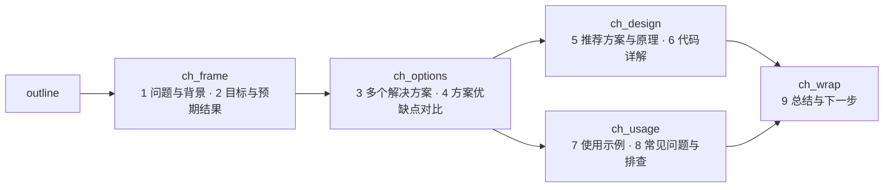

# learn_loop：读完代码后如何写出学习文档

> 依据（均已读过源码/配置，未做端到端实跑）：
> `config/workflows/learn_loop.toml`、`config/workflows/doc_review_loop.toml`、
> `latte-agent-core/src/workflow.rs`（`assemble_draft_from_sections`、`run_learn_control_step`、
> `deterministic_grade_quiz`、`deterministic_learning_ask`）。
>
> 读法：先看 §1 的一句话与 §2 的全景图，再看 §3 的目录树（知道每个文件是谁写的），
> 然后按 §4 的步骤逐个看。§9 是一次完整的示例运行。§10 是已确认的缺陷。

## 1. 一句话

先由 **plan** 读代码、拆出 3–6 个知识点；再由 **doc_review** 让「总编写框架 → 多个 writer
一人一章并发写 → 审稿员对照源码挑错，不合格只让被点名的章重写」；文档由**引擎**拼成
`draft.md` 给学员读；学员答题，答错或有补充就带着反馈回到 doc_review 增强文档；最后 **merge** 定稿。

## 2. 全景图

```
                       ┌────────────────────── QUIZ_FAIL ──────────────────────┐
                       │                                                       │
plan ─► annotate ─► doc_review ─► [引擎装配draft.md] ─► read_confirm ─► quiz ──┤
                       ▲                                (点「开始答题」) (弹窗答题)│ QUIZ_PASS
                       │                                                       ▼
                       └───────────── SUPPLEMENT ◄──────────────────────── supplement
                                                                               │ ALL_DONE
                                                                               ▼
                                                    merge ─► [sync_code 可选] ─► report
```

- `read_confirm`、`quiz` 由引擎确定性执行（弹窗、判分、写账本不走模型）。
- `doc_review` 是一个**嵌套 workflow**（`doc_review_loop`），不是单个模型步。

## 3. 产物目录：每个文件谁写、谁读

学习工作区在**会话目录**下：`.latte/sessions/<会话id>/learn/<slug>/`（模板变量 `{{learn_root}}/<slug>`；
没有会话 id 的独立 run 退回 `.latte/learn/<slug>/`）。学习过程的中间产物都只在这里，任务完成时由 merge
发布到项目的 `docs/learn/`。同一任务换会话重跑时，plan 步开跑前引擎把旧位置或其它会话里同一任务
（按看板编号前缀）/ 同一主题的工作区**拷贝**进本会话，进度（round / wrong / passed）与已写章节接着用：

| 文件 | 谁写 | 谁读 | 作用 |
|---|---|---|---|
| `plan.json` | plan | annotate、outline、writer、proofread、quiz(引擎)、merge | 知识点、证据、例子、题目、答案、`doc_outline` |
| `ledger.json` | plan 初始化；quiz(引擎) 改判分；supplement 记补充 | read_confirm、quiz、supplement、merge、report | 只记事实：`round`、每点 `wrong`/`passed`、`supplements` |
| `code/<kid>-<文件名>` + `code/README.md` | annotate | outline/writer（引用）、merge、sync_code | 注释版代码副本（源码不动） |
| `sections/00_overview.md` | outline | writer（先读它对齐比喻）、引擎装配 | 全局比喻 + 全景链路 + 学习路径 |
| `index.md` | outline | proofread | 阅读入口与各章链接 |
| `feedback.md` | outline | 各 writer | 本轮是全量重写还是局部修补，及按章分组的意见 |
| `sections/<kid>.md` | 每个 writer 各写一个 | proofread、引擎装配 | 一个知识点一章正文 |
| `draft.md` | **引擎装配**（writer 不写） | 学员、merge | 学员阅读的整篇文档 |
| `img/ml-<hash>.svg` | **引擎渲染**（来自 ```memlayout 块） | 学员、merge | 内存布局图 |
| `docs/learn/<主题名>.md` + `docs/learn/<主题名>/` | merge（引擎） | — | 最终交付 + 它引用的章节/副本/图 |

`plan.json` 每个知识点的字段：`id`、`title`、`evidence`(file:line)、`teach_points`、`example`、
`doc_section`、`question`、`options`(4 项)、`answer`。`ledger.json`：`{round, knowledge_points:[{id,wrong,passed}], supplements, _graded_answers}`。

## 4. 步骤详解

### 步骤 1：plan —— 读代码，定「教什么」

- 角色 tutor；工具 `read`/`code_graph`/`search`/`write`，**没有 `ask`**（设计阶段不打扰学员）。
- 引擎要求：必须至少调过一次取证工具、必须 `write` 过（否则重试）。
- 做的事：
  1. 取证：`code_graph` 取签名和行号，`read` 精读，`search` 找宏/字符串。
  2. 拆 3–6 个互不重叠、由浅入深的知识点，第一个必须是「这东西是什么、整体怎么运转」。
  3. 写 `doc_outline`：第 1 节固定为「全局心智模型与贯穿比喻」；涉及分档/分类/分层，必须含
     「怎么存（物理视图）」与「为什么这样存（权衡与反向思考）」。
  4. 每点写 `example`（最小具体例子：传什么进去→出来什么）和一道考理解的四选一题
     （不许考「在第几行」这种查表题，禁 `recommended` 字段，正确项位置自己打乱）。
  5. 落盘 `plan.json`、`ledger.json`（`round:0`，每点 `wrong:0, passed:false`）。同 slug 重跑也必须刷新，不能跳过。
- 输出：**只输出 slug**（3–60 字符，禁空格、`/`、`\`、反引号），下游把它拼进路径（`{{plan_out}}`）。

### 步骤 2：annotate —— 生成注释版代码副本

- 工具只有 `read` + `write`，**没有 `edit`**，所以物理上改不到源文件。
- 按每个知识点的 `evidence` 读原文，逐字保留代码、只加面向零基础的中文注释，写到
  `code/<kid>-<文件名>`；同一文件被多点引用则合并；最后写 `code/README.md` 对照表。
- 作用：让 writer/学员写文档、读文档时有可对照的带讲解代码。

### 步骤 3：doc_review —— 写文档（核心，嵌套 `doc_review_loop`）

引擎把 `slug`、`draft`、`plan`、`ledger` 路径作为 topic 传入。内部分三个 wave：

```
wave0 outline ──► 章节分节写作 5 阶段 ×N（§3.2）──► wave2 proofread ──┐
    ▲                                                                  │
    └──────────────── NEEDS_FIX（最多 3 轮）◄──────────────────────────┘
                                          LOOKS_CLEAR → 返回外层
```

#### 3.1 outline：总编，只搭骨架，不写章节正文

按顺序写三个文件：
1. `sections/00_overview.md`：生活化比喻（把核心角色映射成实体）→ 端到端全景（一次典型操作从头到尾）→
   **学习路径**（每章要回答的**设计问题**，说明这章解决前一章留下的什么矛盾）→ 各章相对链接。
2. `index.md`：一句话主题 + 阅读顺序 + 各章链接与一句话摘要。
3. `feedback.md`：
   - prompt 末尾**没有**「【上轮审查反馈】」→ 写单行 `MODE: FULL`（首轮，全部重写）。
   - **有**反馈 → 写 `MODE: PATCH`，把审稿的每条 ISSUE 原文按章 id 分组抄进去：
     ```
     MODE: PATCH
     ## k3
     - ISSUE: k3 | BLOCKER | 事实错误 | …
     ## overview
     - ISSUE: overview | BLOCKER | …
     ```
     `## overview` 组代表全局意见：outline 当场改 `00_overview.md` 与 `index.md`。
   - outline **不许**自己改 `sections/k*.md`。

#### 3.2 章节分节写作：结构由引擎持有（5 个 fan_out 阶段）

一章固定 9 节，每节一个文件 `sections/<k_id>/<n>_<key>.md`。章节写作拆成 5 个阶段，
每个阶段都是按 `plan.json` 的 `knowledge_points` 每章派发一次的 fan_out step：



「先讲问题、再列方案、再对比、最后讲原理和代码」由流程保证，不靠 prompt：

| 机制 | 作用 |
|---|---|
| `write_path_allowlist` 只放行本阶段的节 | 写方案对比的阶段物理上写不了代码详解，不会把节挤在一起 |
| 引擎注入 `{{chapter_so_far}}`（本章前面已写好的节） | 写对比时一定看得到方案，写代码时一定看得到对比结论 |
| 阶段结束逐节检查（`check_chapter_stage`），不过带原因重试 | 缺节；方案 < 2 个或没有草图；对比表 > 一半单元格是纯形容词；原理节没图；代码节没代码块或没 `file:line`；示例节没代码；FAQ < 2 条；mermaid 首行不是图类型 / 标签含特殊字符没加引号 / 引号不成对 |
| 装配时引擎写 `## 章名` + `### n. 节名`、按 1→9 拼接 | 节的顺序和标题不可能漂移；writer 自写的重复标题被剥掉；缺的节不出空标题 |

- 节检查重试用完按现稿放行并发 Status：一节不够好不值得让整章变成 `FAN_OUT_ITEM_FAILED`。
- 装配结果写回 `sections/<k_id>.md`，所以 index 链接、merge、旧的返工基线都照旧。
  没有分节目录的旧章节仍按整章文件装配。
- 返工（`MODE: PATCH` 且点名本章）：5 个阶段都只派发被点名的章；已有的节抓基线，
  改坏（删出处 / 篇幅缩到六成以下）就还原并重试；与意见无关的阶段回 `UNCHANGED`。
  旧章节没有分节目录时，返工按首写处理——借返工迁移到 9 节结构。
- 素材来源：plan 步的每个决策必须带 `scenario`（带具体输入的场景）、`dimensions`（≥2 个可数的比较维度）、
  `chosen_walkthrough`、各替代方案的 `walkthrough`，至少一个替代方案带 `wins_when`
  （翻转条件），由 `check_learn_plan_design` 机械校验。第 3、4 节就是照着它们展开的。
- 代价：每章模型调用从 1 次变成 5 次（每次范围更小、上下文更短），阶段之间有 wave 屏障。

#### 3.3 proofread：审稿员，只读不改，对照源码核查

- 工具 `read`/`search`/`code_graph`/`doc_graph_context`，必须至少 `read` 一次。
- 顺序：`index.md` → `00_overview.md` → 各章；**每章至少核对 2 处**关键代码/数值与源码一致。
- 也会拿到 `{{chapters_out}}`（各 writer 汇总产出），含 `FAN_OUT_ITEM_FAILED` 或章文件缺失 → 该章缺章 = BLOCKER。
- 分级：

  | 级别 | 内容 | 是否触发返工 |
  |---|---|---|
  | BLOCKER | 事实错误（须亲自读源码确认）；伪代码冒充源码；没讲清设计动机/备选/好处坏处；把猜测写成事实；章序跳跃、前后重复矛盾、只罗列代码；缺章 | 是 |
  | NIT | 措辞、图表偏密、术语铺垫、行号小偏差、排版 | 否 |

- 输出格式：`ISSUE: <k_id 或 overview> | <BLOCKER/NIT> | <类别> | <具体问题> | <应补内容>`；
  章 id 必须写准（返工靠它分派给对应 writer）。
- 最后一行：有任一 BLOCKER → `NEEDS_FIX`，否则 `LOOKS_CLEAR`；除末行外不许出现这两个词。
- 循环参数：`loop_until=LOOKS_CLEAR`，`loop_back_to=outline`，`max_iterations=3`；
  `prompt_token_ratio=0.8`，上下文溢出自动全新重启（最多 2 次，重启时保留 `index.md`）。

#### 3.4 返工一轮到底怎么走（NEEDS_FIX）

1. proofread 输出 `NEEDS_FIX` + ISSUE 列表；
2. 引擎跳回 outline，把 ISSUE 列表作为「【上轮审查反馈】」拼到 outline 的 topic 末尾；
3. outline 见到反馈 → 写 `MODE: PATCH` + 按章分组的 `feedback.md`；
4. 引擎再次 fan_out：被点名的章 writer 只改意见涉及处，其余章输出 `UNCHANGED`；
5. proofread 重审；第 3 轮仍不过则停止循环（保险丝）。

### 步骤 4：引擎装配 draft.md（零模型调用）

`assemble_draft_from_sections`，在 read_confirm 与 quiz 执行前调用：

1. `sections/` 或 `plan.json` 不存在 → 不装配（返回 false）；
2. 若 `plan.json` 有 `design.decisions`，引擎先写入「核心结论与设计决策」
   （一句话结论 + 决策总览表），不依赖 outline 手写；没有 `design` 时跳过，旧文档装配不变；
3. 再拼 `00_overview.md`，然后按知识点顺序逐章；
4. 找章文件：先 `<id>.md`，找不到再匹配 `<id>_*`、`*_<id>`；空文件跳过；
5. 装配时剥掉符号索引 mermaid（节点多数是 `fn xxx` / `struct xxx`），数据流图保留；
6. 各段之间以 `\n\n---\n\n` 分隔，整体覆盖写 `draft.md`；全空则不写。
7. **相对链接改基准**：节文件在 `sections/<id>/`、章与总览在 `sections/`，各自写的相对链接（`k2.md`、
   `../00_overview.md`）拼进上层文件时改写成相对新位置（`draft.md` 里是 `sections/k2.md`）。节里的章节互链
   按约定写 `k2.md`，在节目录下找不到时按 `sections/` 兜底解析。代码块、行内代码、URL、锚点不动。
   此前不改写：draft 里的 `[k1](k1.md)` 指向不存在的 `<slug>/k1.md`，大窗里点开 404。
8. **memlayout → SVG**：```memlayout 块（`lane` / `cell` / `gap` / `ptr` 四种指令）渲染成
   `img/ml-<源码哈希>.svg`，正文换成图片链接；节文件里保留源码，返工改的仍是文本。写作阶段
   `check_chapter_part` 先校验语法（错误带行号打回），并把它算作「图」。写作期另查**偏移连续性**：`@偏移` 必须等于前面各格大小之和
   （跳过的字节要写成 `gap`，重叠说明大小算错）；渲染时不拦，已写好的图照常出 SVG。
   另查**图自己的声明**（`memlayout_claim_problems`）：行说明里的 `= N KiB` 必须等于这一行格子之和，
   标题里的 `= N KiB` 至少等于某一行的总长；数据格（used/free/data）和元数据格（meta）画在同一行、
   行说明里又没有 `file:line` 出处时打回（这是在断言「元数据内嵌在数据区里」，最容易画错）。
   `outline` 步写的 `00_overview.md` 也走同一套检查（只在本步改动过文件时查）。
   装配后清掉不再被引用的 `img/ml-*.svg`。

### 步骤 5：read_confirm —— 等学员读完（引擎）

- 弹一个只有一项「开始答题，验证掌握程度」的窗口，窗口里直接渲染 `draft.md` 内容；
- 题面：`学习材料（第 {round+1} 版）：<learn_root>/<slug>/draft.md。读完了吗？`；
- 卡片里的文档按 `document_path` 所在目录解析相对链接；「大窗查看」里点嵌套 md 在同一窗口打开，带「← 返回」；
  `/api/doc`、`/api/doc-asset` 放行 `.latte/sessions/<sid>/learn/` 子树（会话目录其它内容不暴露）；
- 引擎先查 `AnswerLog.recall(题面)`：**题面文本相同则直接回放上次答案，不弹窗**。

### 步骤 6：quiz —— 判分（引擎，确定性）

1. 从 ledger 取所有 `passed == false` 的知识点，从 plan 取对应题目；
2. 一次 `questions=[...]` 弹全部题，每题题面追加 `［第{wrong+1}次作答］`（避免题面重复被回放）；
3. 判分：按 **label 文本**比对，与选项位置无关；归一化（去首尾空白/收尾标点/忽略大小写）后
   相等，或互相包含（正确 label ≥2 字才允许包含）即对；乱填、空、自由文本按错；
4. 改账本：答对 `passed=true`；答错 `wrong+1`；用 `_graded_answers` 的 `id:attempt` 做回执，重放不重复计数；
5. 输出：逐题「判分结果 / 你选的是」；答错题附正确答案、一句「为什么」（该点 `teach_points` 首条）、
   `file:line`，并列出该点 `requires` 里仍未掌握的前置；末行 `QUIZ_PASS`（全对）或 `QUIZ_FAIL`。
6. `QUIZ_FAIL` → 引擎跳回 `doc_review`，这段判分文本整体成为「【上轮审查反馈】」，
   即 outline 会把它当作章级意见，走 3.4 的 PATCH 路径，让答错点对应的章增强「易错点辨析」。
7. `max_iterations=10` 为保险丝，不设「错几次放弃」。

### 步骤 7：supplement —— 全对后收集补充（模型步）

- 一个只有「没有了，全部理解」的窗口；想补充的学员走自动附带的「其他（自定义）」输入；
- 题面必须带轮次号（防回放）；
- `没有了` → 写一次 ledger（仅刷新 `updated_at`）→ 末行 `ALL_DONE`；
- `其他：<内容>` → 把原文追加进 `ledger.supplements`（`{round, asked}`）→ 末行 `SUPPLEMENT`，
  引擎跳回 `doc_review`，补充内容作为反馈让 outline 分派。

### 步骤 8：merge、sync_code、report

- **merge**（引擎确定性，不调模型）：`finalize_learn_doc` 把装配好的 draft 加标题、目录，有注释副本则文末附索引；
  定稿名 = slug 去掉看板任务编号（`lat-110-jemalloc-size-class` → `jemalloc-size-class`），写
  `docs/learn/<主题名>.md`；定稿引用的文件**及其传递闭包**（章节 md 里再链到的章/图/副本）拷到
  `docs/learn/<主题名>/`（目录带 `.latte-learn-assets` 标记，每次定稿整体重建），链接改指那里——
  定稿不依赖会话目录。只拷闭包不拷整目录：工作区跨会话沿用，`sections/` 里留着旧 plan 的章
  （实测 LAT-110：plan 从 7 点变 4 点后 k5–k7、appendix 还在）。
  写完按出处/图数/篇幅自检。
  早先由模型整篇重写；9 节结构下实测 4 章 draft 191KB，一次 write 远超模型输出上限。
- **sync_code**（可选，主题含「同步注释」/「写进源码」才跑）：`edit` 把注释写进真实源码，
  只改注释、以代码原文为锚点，找不到锚点就跳过并说明。会修改仓库，建议开 isolated worktree。
- **report**（只读）：输出掌握进度 X/Y、答错次数、补充清单、交付路径。

## 5. 硬约束速查（都是引擎字段，不是 prompt 劝告）

| 想防止的问题 | 机制 |
|---|---|
| writer 覆盖别人的章 | `write_path_allowlist` |
| 一章失败拖垮全篇 | `fan_out.tolerate_failures` + 审稿判缺章 |
| 模型凭记忆写文档 | plan/writer 必须读源码；审稿每章核对 2 处 |
| 伪代码冒充源码 | writer 标准 + proofread BLOCKER |
| 文档顺序漂移/丢内容 | 引擎按 plan 顺序装配 |
| annotate 改到源码 | 无 `edit` 工具 |
| 返工范围失控 | `feedback.md` 按章分组 + `UNCHANGED` |
| 审稿无限循环 | `max_iterations=3`；外层 quiz/supplement 各 10 |
| 上下文爆掉 | `prompt_token_ratio` + 自动重启 |
| 图与自己的说明/格子对不上 | `memlayout_claim_problems`（声明总数对账、内嵌元数据要出处），章节各节与总览都查 |

## 6. 一次完整示例（3 个知识点 k1/k2/k3）

1. plan 写出 3 点，`ledger.round=0`；输出 slug `demo`。
2. annotate 生成 `code/k1-*.rs` 等副本。
3. doc_review 第 1 轮：outline 写 overview/index、`MODE: FULL`；3 个 writer 并发写 `k1.md`/`k2.md`/`k3.md`；
   proofread 报 `ISSUE: k2 | BLOCKER | 事实错误 …` → `NEEDS_FIX`。
4. 第 2 轮：outline 写 `MODE: PATCH` + `## k2`；k1、k3 writer 输出 `UNCHANGED`，只重写 k2；proofread `LOOKS_CLEAR`。
5. 引擎拼出 `draft.md`；read_confirm 弹「第 1 版」，学员读完点击。
6. quiz：k1 对、k2 错、k3 对 → 账本 `k2.wrong=1`，`QUIZ_FAIL`，判分文本回到 outline。
7. doc_review：outline `PATCH` + `## k2`（来自判分反馈）→ 只重写 k2 加易错点辨析 → 再拼 draft.md。
8. read_confirm → quiz（只考 k2，题面 `［第2次作答］`）→ `QUIZ_PASS`。
9. supplement：学员输入「想了解锁竞争」→ `SUPPLEMENT` → 回 doc_review 补内容 → 再答 → `ALL_DONE`。
10. merge 定稿，report 输出 3/3。

## 7. 前置条件与失败处理小结

- 任何一步 `require_tools`/`output_contract` 不满足，引擎按 `max_retries` 重试，再失败则 workflow 失败；
- `plan.json` 或 `ledger.json` 缺失，`run_learn_control_step` 直接返回错误；
- 引擎不会阻止你手改 `draft.md`，但下次装配会被 `sections/` 覆盖——要改请改章文件。

## 8. 与旧设计文档的差异

`docs/learn-loop-doc-driven-design.md` §5 的表格与 §5.2（`doc` 单步、`loop_back_routes = doc`）
已过期，现行为 `doc_review` 嵌套 workflow；该文档未同步。

## 9. 缺陷与修复记录

1. **`ledger.round` 从不自增（已修复）**。原因：设计文档里「doc 步 round+1」随 doc→doc_review
   迁移丢失，全仓只有 `read_confirm` 读它。后果：返工后 `read_confirm` 题面仍是 `第 1 版`，
   `AnswerLog::recall`（`workflow.rs` `deterministic_learning_ask`）静默回放旧答案、不弹窗。
   修复：引擎函数 `bump_learn_round`，在 learn_loop 的 quiz（QUIZ_FAIL）/ supplement（SUPPLEMENT）
   触发 `Rework` 跳回 `doc_review` 时自增 `ledger.round` 并写盘（两处 `SerialLoopNav::Rework` 分支）。
   验证：单测 `bump_learn_round_increments_persisted_round`；`quiz_fail_reworks_to_doc_then_pass_advances` 仍通过。
   未做端到端实跑。
2. **quiz 判分反馈没有专属的章 id 分组（已修复）**。原先反馈是自由文本，outline 要自己拆出 `## k2`，
   拆错会让该增强的章被 `UNCHANGED` 跳过。修复：`format_quiz_feedback` 在有答错时追加
   「【按章分组的返工意见】」块（引擎确定性生成，只含答错的章，格式 `## <k_id>\n- …`），
   `doc_review_loop` 的 outline prompt 要求把该块原样抄进 `feedback.md`。
   验证：单测 `quiz_feedback_groups_wrong_points_by_chapter_id`；未做端到端实跑。
   残余风险：抄录仍由 outline 模型执行，只是不再需要它判断章 id。
3. **方案对比讲不透、原理与代码挤在一起（已改为流程约束）**。单个 write_chapter 一次写整章时，
   prompt 里列的 7 段要求在产出里退化：对比表全是「灾难级 / 极低 / 极佳」，配了编造的性能数字
   （「暴跌至单核的 10%」），全景图的 mermaid 标签 `arena->bins[bin_ind]` 没加引号、页面渲染失败
   （实测 jemalloc `lat-111-jemalloc-arena`）。修复见 §3.2：拆成 5 个阶段 × 9 节、引擎持有结构与检查。
   验证：对该实测文档跑新检查，overview 报出 5 处未加引号标签，k1-k4 均报缺方案对比各节、0 张图；
   单测 `chapter_part_checks_are_mechanical_per_section` 等。未做端到端实跑。
4. **端到端实跑（2026-10-02，主题 choice.rs resolve/resolve_one，glm-5.3）暴露的问题（已修复）**：
   - plan 被打回后**整轮重新取证**（单次 ~9 分钟）：批注改为「plan.json 保留原处，只改点名字段」；
   - evidence 写成 `src/choice.rs:255-317, 606-608`，续写段被判格式错误：续写行号沿用前一个文件（`split_learn_evidence`）；
   - 重试时模型在 slug 前加一句说明，被 60 字符契约打回又白跑一轮：取末行 slug（`trailing_slug`）；
   - 对比深度（wins_when 等）卡死 plan 的风险：重试用完时只放行深度项，证据/题目错误仍判死；
   - merge 让模型重写 191KB 定稿必然截断：改为引擎定稿；
   - 总览小节与章名同为 `##`，定稿目录混排：总览挂到「全局总览」下并降级。
   实测结果：4 章 × 9 节全部按序装配，逐节检查一次通过（无重试），22 张 mermaid 全部通过 mermaid.parse；
   对比表单元格为具体值。耗时：plan 18 分钟（3 次尝试）、annotate 2.5 分钟、文档 5 阶段 28 分钟。
5. **图文不一致：总览里的内存布局图多画了一块不存在的内嵌头部（已加机械对账，语义层仍有缺口）**。
   实测 jemalloc `lat-110`：总览的 slab 图画成「1 KiB 位图元数据头 + 14 KiB 槽 0 + 14 KiB 槽 1」（共 29696 B），
   而行说明写「7 个 4KB 页 = 28 KiB」，各章里同主题的图也是 28672 B、无头部。源码事实：
   `arena_slab_reg_alloc` 用 `edata_addr_get(slab) + reg_size * regind` 算地址（`src/arena.c:235-237`），
   位图在带外的 `edata_t.e_slab_data`（`edata.h:246`），slab 数据页就是 `nregs × reg_size` 一整块。
   漏网原因：(a) `outline` 步没有任何质量门，总览里的图连语法都没被 lint；(b) 现有检查只看语法和 `@偏移` 连续，
   这张图格子自己加起来是连续的；(c) 总览先于各章写成，之后没有环节回头核对图与图、图与文；(d) 审稿步已移除，
   没有任何环节拿图去对源码。
   修复：`memlayout_claim_problems`（声明总数对账 + 内嵌元数据要 `file:line`）接入 `lint_memlayout_blocks`，
   章节各节与 `outline` 写的总览都走它；writer prompt 要求画之前读源码核实地址/偏移怎么算。
   验证：对该工作区的 8 个真实 memlayout 块跑新检查，只命中总览那 1 个（命中原因：声明 28672 B、格子 29696 B），
   其余 7 个零误报；单测 `memlayout_claims_*`、`overview_figures_are_linted_with_claim_check`。未做端到端实跑。
   **残余缺口（机械检查做不到的）**：声明与格子自洽、又给了一个看似合理的 `file:line`，但结构本身画错，
   仍会漏过去——出处只做格式检查，不核对内容；图与正文其它位置的数值（如 232 vs 235、4096 vs 8192）互相矛盾也不查。
   补这一层需要独立于 writer 的「图文核对」审稿（拿图里每个 cell/ptr 对源码），代价是重新引入一个会拖慢学员的环节，见讨论。
