# 《latte-agent 源码精读》第 1 编第 1 章：choice 模块的多题弹框收齐机制

> **一句话概括**：子代理调用 `ask` 向用户提问时会被**挂起**等待答案；一轮弹框若同时问好几道题，就必须等**每一道题都作答完**才放行一次，否则智能体会拿着半份信息提前动手。本章讲清这套「收齐才放行」机制怎么运转，落点在 `latte-agent-core/src/choice.rs` 的 `resolve_one`（`latte-agent-core/src/choice.rs:272-301`）。

## 目录

- [本章前置](#本章前置)
- [1. 阻塞 ask 与全局答案路由](#1-阻塞-ask-与全局答案路由)
  - [1.1 核心运作：choice_id 与 oneshot 通道](#11-核心运作choice_id-与-oneshot-通道)
  - [1.2 易错点辨析：为什么不是「轮询」或「标准输入」](#12-易错点辨析为什么不是轮询或标准输入)
- [2. 为什么需要收齐：部分作答提前放行问题](#2-为什么需要收齐部分作答提前放行问题)
- [3. Pending 状态设计：expected 与 collected](#3-pending-状态设计expected-与-collected)
  - [3.1 逐字段精读](#31-逐字段精读)
  - [3.2 全局路由表 PENDING](#32-全局路由表-pending)
- [4. resolve_one 的收齐判定与按序拼接](#4-resolve_one-的收齐判定与按序拼接)
  - [4.1 逐行剖析收齐流转](#41-逐行剖析收齐流转)
  - [4.2 走一遍：两道题依次作答](#42-走一遍两道题依次作答)
- [5. 单题兼容与异常防御机制](#5-单题兼容与异常防御机制)
  - [5.1 单题形态零成本向下兼容](#51-单题形态零成本向下兼容)
  - [5.2 重复作答与脏题号防御](#52-重复作答与脏题号防御)
  - [5.3 返回值语义对照速查表](#53-返回值语义对照速查表)
- [6. PENDING 表的并发处理](#6-pending-表的并发处理)
  - [6.1 一张表 + 一把锁](#61-一张表--一把锁)
  - [6.2 为什么 resolve_one 要把整段判断放在锁里](#62-为什么-resolve_one-要把整段判断放在锁里)
  - [6.3 走一遍：两题答案同时到达](#63-走一遍两题答案同时到达)
  - [6.4 收齐在锁内，还有什么要操心的](#64-收齐在锁内还有什么要操心的)
- [7. 全局流程图](#7-全局流程图)
- [注释版代码副本](#注释版代码副本)

---

## 本章前置

本章属于《latte-agent 源码精读》第 1 编「人机交互与异步协作」第 1 章（章节编号 1.1）。

- **前置依赖**：作为第 1 编的开篇章节，本章无前序章节依赖；
- **学习预期**：默认读者具备基础的编程概念（了解什么是函数调用、返回值与键值对字典），无需预先掌握高级异步运行时或锁底层机制。我们将从最直观的交互场景切入。

---

## 1. 阻塞 ask 与全局答案路由

在日常与 AI 助手交互时，我们最熟悉的方式是：AI 发一条消息问我们，我们在输入框回复，AI 拿到回复后触发下一轮对话。这种「问完不管、下一轮对话自然带回输入」的模式，在工程上叫 **fire-and-forget（发后即忘）**。

但在更复杂的智能体系统（如多工作流并发的子代理）里，情况完全变了：
子代理（workflow 或 delegate 子任务）是后台运行的自动化流程，它**没有**所谓「下一轮对话输入」的上下文通道。当它需要向人类确认关键决策（比如「请选择部署环境与测试等级」）时，如果发完弹框就继续往下执行，就会完全脱缰。因此，子代理必须在调起选择框的这一刻**挂起等待**（停止执行），直到用户在界面点下选项才被唤醒继续。

为了让网页端用户点击的答案准确送回那一个挂起的子代理，系统设计了 `choice` 模块。

### 1.1 核心运作：choice_id 与 oneshot 通道

`choice` 模块（位于 `latte-agent-core/src/choice.rs:1-29`）的核心工作极其清晰：**给每一次弹框发一张专属号牌（`choice_id`），并架设一条一次性答案专用通道（`oneshot` 通道）**。

> **术语：oneshot 通道（一次性通道）**
> 可以把它想象成一个「只能投递一次的信箱」。发信人投递一封信（答案）后信箱就立即关闭，收信人取出信件后流程继续。这种通道只能使用一次，天然杜绝了重复投递或脏数据混入。

当子代理需要用户选择时，在 `latte-agent-core/src/choice.rs:206-230` 执行 `register` 注册：

1. 生成全局唯一的 `choice_id` 编号（进程内单调递增，绝不重复）；
2. 创建一对 oneshot 发送端 `tx` 与接收端 `rx`；
3. 将发送端 `tx` 存入全局的挂起表 `PENDING`；
4. 子代理拿到接收端 `rx` 并挂起等待（`.await`）；
5. 用户在网页端点击后，前端发起请求携带 `choice_id`，系统找到对应的 `tx` 将答案投递进去，子代理瞬间被唤醒。

```
[子代理 ask] ──(1. 注册 choice_id & tx)──> [PENDING 路由表: choice_id -> tx]
     │                                                     ▲
 (拿着 rx 挂起等待)                                          │
     │                                            (2. 提交答案 POST)
     ▼                                                     │
[子代理被唤醒继续跑] <──────(3. tx.send(答案))────────────── [Web 界面用户点击]
```

### 1.2 易错点辨析：为什么不是「轮询」或「标准输入」

「子代理怎么知道答案来了」这个问题，最常见的误答是「不断轮询数据库事件日志」——因为我们都熟悉后台任务靠反复查进度表推进的设计。但在这个场景下，轮询和实际机制有本质区别。

#### 1.2.1 阻塞等待与轮询检查的区别

轮询（polling）意味着「程序定期醒来检查一下有没有新消息」。但子代理调用 `ask` 后是**彻底挂起**：它把接收端 `rx` 拿在手里执行 `.await`，线程直接休眠，不占 CPU，也不检查任何东西。直到 oneshot 通道的 `tx.send()` 把答案投递进来，异步运行时才会唤醒它（`latte-agent-core/src/choice.rs:5-6, 206-229`）。

对比：

- **轮询数据库**：子代理每隔 100ms 醒来查一次 `SELECT answer FROM events WHERE choice_id=...`，直到查到非空才继续。这会带来延迟、CPU 浪费和数据库压力。
- **oneshot 路由**：子代理根本不醒。它只在注册时留下「钥匙孔」（`choice_id`），用户点击后 `resolve` 函数从 `PENDING` 表里精确找到那个锁孔，把答案 `send` 进去，子代理立刻复活。零延迟、零轮询。

#### 1.2.2 关键区分：谁持有等待权

在 oneshot 模型里，**等待的是接收端（rx），发送端（tx）由 PENDING 表保管**。当 `POST /api/chat/choice-answer` 到来时，`resolve` 拿着 `choice_id` 去表上取出 `tx`，调用 `tx.send(答案)` 完成投递。如果发送端丢了或找错了通道，答案就永远送不到，但绝不存在「子代理每隔一会儿去看看有没有信」的轮询行为。

#### 1.2.3 为什么不用数据库或 WebSocket

- **数据库事件日志**：多一层 IO，延迟不可控，且需要额外清理逻辑。oneshot 是内存级操作，适合毫秒级响应的人机交互。
- **WebSocket 广播**：那是前端技术选型。后端子代理和前端之间的桥梁是 `POST /api/chat/choice-answer` 这个 HTTP 端点，它内部调用的正是 `resolve` 与 `tx.send()`（`latte-agent-core/src/choice.rs:247-256`）。
- **进程标准输入**：那是 CLI 时代的交互方式。这里的系统是多并发 Web 服务，没有控制台可 stdin。

**易错点小结**：

- **oneshot 通道路由**：「登记钥匙孔 → 挂起休眠 → 精确投递 → 瞬间唤醒」，这才是本模块的实现；
- **轮询数据库事件日志**：「不断醒来查询 → 有延迟、耗资源、并非本模块实现」，这是最常见的误认。

**人话总结**：阻塞 ask 就是子代理凭一张独一无二的号牌在系统里押下一个信箱，自己停在原地等信；网页端拿着号牌把答案投进信箱，子代理收信后继续开工。没有轮询，没有数据库，只有一对一的 oneshot 精准投递。

本节对应注释副本：`.latte/learn/choice-multi-question-resolve/code/k1_ask_routing-choice.rs`

---

## 2. 为什么需要收齐：部分作答提前放行问题

在只问一个问题的单选场景下，上述机制运行得天衣无缝：用户点一个选项，答案立刻送达。
但真实工程场景往往是一次弹框同时抛出多个问题（例如项目初始化时同时询问：1. 编程语言；2. 目标平台；3. 日志等级）。

如果用户在网页上逐题作答，系统每收到一道题的答案就当成最终答案唤醒子代理，会发生什么？

### 2.1 源码注释里记录的现场故障

这个缺陷是怎么被发现的，`resolve_one` 的文档注释里写得很清楚（`latte-agent-core/src/choice.rs:266-271`）：

> # 为什么要收齐
>
> 顶层 `ask` 是 fire-and-forget、每个答案各自成一个 turn，于是"一轮问
> 3 题"会让角色在只拿到部分答案时就往下走。实测（2026-09-07 jemalloc
> 会话）manager 问 3 题、用户答完 2 题它就启动了 4 条 workflow，剩下
> 2 题的答案在那些流水线跑完之后才到 —— 前面全按默认假设做了。

翻译成场景：管理者代理（manager）一次向用户抛出 3 道确认题。用户刚答完前 2 题，系统若把部分答案当成完成，manager 就会在只拿到 2 个答案的情况下提前行动，一口气启动 4 条消耗庞大资源的流水线。剩下那道至关重要的题目答案，等这些耗时繁重的流水线全跑完之后才送达，而前面所有的重型任务早已按默认缺省假设跑完了。

这就是**部分作答提前放行缺陷（partial answer problem）**。

- **问题本质**：并不是后面的答案丢了，而是**放行太早**。智能体拿着半吊子的信息提前下结论干粗活，导致后续不可挽回的决策跑偏。
- **解决原则**：多题弹框必须做到**严格收齐才放行**——只要还有一题没答完，子代理就必须老老实实继续挂起等待（`latte-agent-core/src/choice.rs:47-49, 260-261`）。

**人话总结**：三道题只答了两道就放行，等于体检报告还没出全医生就先给病人开刀；必须等到全部结果汇总齐全，智能体才能拿到完整决策依据。

本节对应注释副本：`.latte/learn/choice-multi-question-resolve/code/k2_partial_answer_problem-choice.rs`

---

## 3. Pending 状态设计：expected 与 collected

要解决上述缺陷，核心在于让挂起状态（`Pending`）拥有「知道应答哪几道题」和「记录已答哪几道题」的能力。

在 `latte-agent-core/src/choice.rs:36-56` 中，结构体 `Pending` 的字段设计把这件事拆得明明白白：

```rust
// 源码摘录：latte-agent-core/src/choice.rs:36-53
struct Pending {
    /// 答案投递通道（一次性）。
    answer: oneshot::Sender<String>,
    /// 原始 ChatEvent::ChoiceRequested 快照，供重连补发。
    event: ChatEvent,
    /// 该弹框所属的事件通道（= session 的 broadcast）。
    chan: broadcast::Sender<ChatEvent>,
    /// 多题弹框期待的题目 id 列表（按题序）。空 = 单题形态。
    expected: Vec<String>,
    /// 已收到的逐题答案（question_id -> answer）。
    collected: HashMap<String, String>,
}
```

### 3.1 逐字段精读

1. `answer: oneshot::Sender<String>`：一次性答案投递端，当且仅当全部题目收齐时才会调用它的 `send` 方法；
2. `event: ChatEvent`：保存了弹框发出时的完整快照（包含界面文字、选项），如果用户中途刷新网页或断网重连，重连的网页能从该快照立刻无损还原弹框；
3. `chan: broadcast::Sender<ChatEvent>`：标识该弹框属于哪个会话通道，多窗口切换时绝不串门；
4. `expected: Vec<String>`（**应到名单**）：有序记录弹框包含的题目 ID（如 `["q1", "q2", "q3"]`）。如果只有 1 道题，此列表留空，保持对老单题逻辑的零开销兼容；
5. `collected: HashMap<String, String>`（**实到记录**）：一个键值对字典（如 `{"q1": "Rust", "q2": "macOS"}`），保存已经收到答案的题目与具体选项。

「应到名单」是在注册时一次性写好的：`register` 从 `ChoiceRequested` 事件里抽出题目 id，**只有题目数大于 1 才填充**，否则留空走单题形态（`latte-agent-core/src/choice.rs:213-218`）：

```rust
// 源码摘录：latte-agent-core/src/choice.rs:212-218
// 多题弹框：从事件里抽出题目 id 作为"收齐"判据。
let expected: Vec<String> = match &event {
    ChatEvent::ChoiceRequested { questions, .. } if questions.len() > 1 => {
        questions.iter().map(|q| q.id.clone()).collect()
    }
    _ => Vec::new(),
};
```

### 3.2 全局路由表 PENDING

在 `latte-agent-core/src/choice.rs:55-56`，定义了存储所有挂起项的全局表：

```rust
static PENDING: LazyLock<Mutex<HashMap<String, Pending>>> =
    LazyLock::new(|| Mutex::new(HashMap::new()));
```

- **LazyLock（懒加载初始化）**：系统第一次使用时才分配内存；
- **Mutex（互斥锁）**：保证多线程并发下更新或读取挂起项时数据不会发生混乱冲突。

这里只需要记住「一张表 + 一把锁」这个结论；它为什么是并发安全的关键、两个请求同时到达会怎样，是[第 6 节](#6-pending-表的并发处理)的主题。

**人话总结**：`expected` 就像班级点名册上的应到学号，`collected` 是已经签到的同学记录；只有当每一个应到学号都签了到，班长才会关门汇报。

本节对应注释副本：`.latte/learn/choice-multi-question-resolve/code/k3_pending_state-choice.rs`

---

## 4. resolve_one 的收齐判定与按序拼接

多题收齐逻辑的核心枢纽是 `resolve_one` 函数。每当用户在前端界面作答完多题中的某一道题时，前端就会发起一次针对该题的提交。

我们精读位于 `latte-agent-core/src/choice.rs:272-301` 的核心逻辑：

```rust
// 源码摘录：latte-agent-core/src/choice.rs:272-301
pub fn resolve_one(choice_id: &str, question_id: &str, answer: String) -> Result<bool, ()> {
    let mut g = PENDING.lock().unwrap();
    let Some(p) = g.get_mut(choice_id) else {
        return Err(());
    };
    // 单题形态没有 expected：按整体答案处理，保持既有语义。
    if p.expected.is_empty() {
        let p = g.remove(choice_id).expect("just checked");
        return Ok(p.answer.send(answer).is_ok());
    }
    if !p.expected.iter().any(|id| id == question_id) {
        // 未知题号：不能当成"收齐进度"，否则永远收不齐。
        return Err(());
    }
    p.collected.insert(question_id.to_string(), answer);
    if p.collected.len() < p.expected.len() {
        return Ok(false);
    }
    // 收齐 → 按题序拼成一份可读答案交给等待方。
    let p = g.remove(choice_id).expect("just checked");
    let joined = p
        .expected
        .iter()
        .filter_map(|id| p.collected.get(id).map(|a| (id, a)))
        .enumerate()
        .map(|(i, (_, a))| format!("{}. {a}", i + 1))
        .collect::<Vec<_>>()
        .join("\n");
    Ok(p.answer.send(joined).is_ok())
}
```

### 4.1 逐行剖析收齐流转

1. **查表定位与加锁**（第 273-276 行）：
   锁定全局表并根据 `choice_id` 取出 `Pending`。若号牌不存在（或已超时取消），直接返回 `Err(())`，通知前端该提问已失效；
2. **非法题号防御**（第 282-285 行）：
   检查传入的 `question_id` 是否在 `p.expected` 名单里。如果不在，果断拦截返回 `Err(())`。这一步非常关键：如果不拦截，脏题号会撑大字典长度，导致虚假收齐；
3. **答案记录与收齐判定**（第 286-289 行）：
   执行 `p.collected.insert(question_id.to_string(), answer)` 将此题答案记入。
   接着判断：`if p.collected.len() < p.expected.len()`。只要实收题数还小于期待总数，**直接返回 `Ok(false)`**。挂起项留在表中，子代理绝不被唤醒；
4. **收齐放行与按序拼接**（第 290-300 行）：
   当且仅当全部收齐时，才执行 `g.remove(choice_id)` 摘除挂起项。
   摘除后，遍历原始的 `p.expected` 题号顺序，从 `collected` 中取出对应的选项文本，拼接成易于模型阅读的带标号纯文本：

   ```text
   1. 选项A内容
   2. 选项B内容
   3. 选项C内容
   ```

   最后调用 `p.answer.send(joined)` 把合并好的答案送入信箱，返回 `Ok(true)`。挂起的子代理收到信件，带着全部答案满血唤醒。

「按题序编号」这一点有测试兜底：`multi_question_waits_until_every_answer_arrives` 断言收到的文本以 `1. 小白` 开头（`latte-agent-core/src/choice.rs:640-644`）。

### 4.2 走一遍：两道题依次作答

弹框 `expected = ["q1", "q2"]`，用户依次作答：

| 步骤 | 调用 | 表内状态 | 返回 |
|---|---|---|---|
| 用户答 q1 | `resolve_one(id, "q1", "小白")` | `collected = {"q1": "小白"}`，挂起项留在表里 | `Ok(false)` |
| 用户答 q2 | `resolve_one(id, "q2", "清单+教程")` | 收齐，摘除挂起项 | `Ok(true)`，等待方收到 `"1. 小白\n2. 清单+教程"` |

**人话总结**：答一道收一道，只要没收全就回 `Ok(false)` 继续等；收齐的瞬间按最开始的题目顺序编号成清单，一次性投进信箱唤醒后台代理。

本节对应注释副本：`.latte/learn/choice-multi-question-resolve/code/k4_resolve_one_mechanism-choice.rs`

---

## 5. 单题兼容与异常防御机制

在大型系统架构中，任何新功能引入都必须坚守两条防线：**向下兼容旧逻辑** 与 **恶意或异常输入的防御**。`resolve_one` 在这两点上给出了模范实现。

### 5.1 单题形态零成本向下兼容

（`latte-agent-core/src/choice.rs:277-281`）

系统里存在大量的单题弹框。单题弹框在 `register` 时 `p.expected` 为空列表。
当 `resolve_one` 发现 `p.expected.is_empty()` 时，它不会强行要求多题匹配，而是立刻当作单题整体直接摘除挂起项，将原始 `answer` 发送给等待方。老代码与既有单题逻辑无缝衔接。

### 5.2 重复作答与脏题号防御

（`latte-agent-core/src/choice.rs:282-286`）

- **同一题重复提交**：因为 `collected` 是 `HashMap`，针对相同 `question_id` 重复作答只会覆盖旧值，字典长度并不会虚假增加，绝不会造成「同一题选两次冒充两题收齐」的安全漏洞；
- **伪造不存在的题号**：若外部传入不存在于 `expected` 的 `question_id`，立即返回 `Err(())`，绝不允许脏键污染字典导致收齐计数器被篡改。

重复作答这条也有测试守住（`latte-agent-core/src/choice.rs:648-659`）：对 `q1` 连答两次都返回 `Ok(false)`，直到 `q2` 到达才 `Ok(true)`，且最终文本里取的是 `q1` 的最新值。

### 5.3 返回值语义对照速查表

| 返回值 | 业务含义 | PENDING 表状态变化 | 后台子代理状态 |
|---|---|---|---|
| `Ok(false)` | 单题已收下，仍有题目待作答 | 保留在表中，`collected` 新增一项 | 维持挂起，继续等待 |
| `Ok(true)` | 全部题目收齐，格式化答案已送达 | 从表中彻底移除（摘除挂起） | 收到完整文本，立即唤醒继续执行 |
| `Err(())` | 未知 choice_id 或非法 question_id | 表状态无任何变更 | 不受影响（无有效数据投递） |

---

## 6. PENDING 表的并发处理

前面章节说 PENDING 是「进程级路由表」，但没细说一件事：这张表同时被好几方使用——`register` 由发起 ask 的子代理调用、`resolve_one` 由 HTTP 接口收到某一道题的答案时调用、`cancel` 由超时或 Drop 触发。它们可能几乎同一时刻到达。这一节讲系统怎么让它们不打架。

### 6.1 一张表 + 一把锁

回到 `latte-agent-core/src/choice.rs:55-56` 这行定义（代码见 [3.2 节](#32-全局路由表-pending)），把它拆成三层读：

- **`static`（静态全局）**：整个进程只有一份，所有函数共享同一张表；
- **`LazyLock`（懒加载锁）**：第一次被使用时才真正创建这张表，进程刚启动时不占内存；
- **`Mutex`（互斥锁）**：表外面套了一把锁。任何任务想读写这张表，必须先 `lock()` 拿到锁；拿到锁的这段时间叫「临界区」，同一时刻只允许一个任务在里面，其它任务在 `lock()` 处排队。

生活类比：PENDING 是只有一本的记账本，锁是本子上挂的一支笔——谁要登记谁先拿笔，拿到笔的人才能翻开写，写完把笔放回去，下一个再拿。

于是你在整个文件里看到的所有访问都长一个样子：`PENDING.lock().unwrap().干某件事`。`lock()` 返回一个「守卫对象」（MutexGuard），守卫对象销毁时自动还锁——Rust 里不需要手动「解锁」，出了作用域锁就自动归还，这从语法上杜绝了「忘了还锁导致所有人永远排队」这种事故。

### 6.2 为什么 resolve_one 要把整段判断放在锁里

并发真正危险的地方在 `resolve_one`。看多题场景下两个请求「同时」到达会发生什么——代码就是[第 4 节](#4-resolve_one-的收齐判定与按序拼接)完整贴出的那段（`latte-agent-core/src/choice.rs:272-301`），这里只顺着关键动作走一遍：

1. `PENDING.lock().unwrap()`——从这里开始持有锁，直到函数返回；
2. `g.get_mut(choice_id)`——在表里找这个弹框，找不到直接 `Err`；
3. 校验 `question_id` 必须在 `expected` 名单里，防止野答案破坏计数；
4. `p.collected.insert(...)`——把这一题记进实到名单。因为持有锁，这个写入不会和别的请求穿插；
5. `collected.len() < expected.len()` 就 `Ok(false)` 返回——锁随之归还，挂起项留在表里等下一题；
6. 收齐则在锁内 `remove` 把表项摘掉、再 `send` 放行——摘表和放行是同一个临界区里完成的，所以**收齐瞬间只有一个任务能看到，也只放行一次**。

### 6.3 走一遍：两题答案同时到达

弹框 `expected = ["q1","q2"]`，用户连点两题，两个 HTTP 请求 R1（答 q1）、R2（答 q2）并发到达后端：

- 若 R1 先拿到锁：它 `insert("q1")`，`1 < 2` 收不齐，返回 `Ok(false)`，还锁。表里 `collected={"q1":..}`。R2 等到锁后 `insert("q2")`，`2 = 2` 收齐，`remove` 摘表，`send`，返回 `Ok(true)`。
- 若 R2 先拿到锁：过程完全对称——它只负责把 `"q2"` 记进去并返回 `Ok(false)`，收齐放行留给后到的 R1 完成。

**顺序无所谓、谁最后无所谓**——锁保证「记账」和「放行」永远不会穿插进行，所以并发到达的结果永远等价于「两个请求按某种先后顺序串行执行」。测试 `multi_question_same_answer_twice_does_not_fake_completion` 也从另一个角度验证了这点：同一题被重复回答只是覆盖，进度不会虚涨（`latte-agent-core/src/choice.rs:648-659`）。

### 6.4 收齐在锁内，还有什么要操心的

- **重复或迟到清理是幂等的**：`cancel` 就是锁内 `remove`（`latte-agent-core/src/choice.rs:303-306`）。源码注释也明确了这一点：「`cancel` 是幂等的——答案已送达后 remove 不存在的键无副作用」（`latte-agent-core/src/choice.rs:308-310`）。「答案已送达放行」之后再触发超时清理，只是 `remove` 一个不存在的键，无副作用。
- **register 的写入也在锁内**（`latte-agent-core/src/choice.rs:219-229`）：两个子代理几乎同时发起 ask，也只会有一个先登记、另一个再登记，不会写一半互相覆盖。
- **为什么不把 `send` 挪到锁外**：`oneshot::Sender::send` 本身是非阻塞的（接收端是 tokio 任务，不占线程），留在锁内反而保证「摘表 → 放行」是一个原子动作——不会出现「表项已删但答案没发出去」的中间态被别的查询看到。

**人话总结**：PENDING 这本账只有一本、笔只有一支；每次回答都要先拿笔才能记账，所以「记到哪了、够不够放行」永远只有一个任务在判断——两题答案同时到达，也只会被串行成「先后两笔」，收齐只放行一次。

本节对应注释副本：`.latte/learn/choice-multi-question-resolve/code/k5_pending_concurrency-choice.rs`

---

## 7. 全局流程图

以下为整个多题弹框收齐机制的核心流程（基于 `choice.rs` 实际逻辑绘制）：

```mermaid
flowchart TD
    A[前端调用 resolve_one(choice_id, question_id, answer)] --> B{choice_id 是否在 PENDING 表中?}
    B -- 否 / 已超时 --> C[返回 Err(())]
    B -- 是 --> D{是否为单题弹框\np.expected.is_empty()?}
    D -- 是 --> E[直接从表中摘除\nsend(原始answer) -> 返回 Ok(true)]
    D -- 否 --> F{question_id 是否在 p.expected 中?}
    F -- 否 --> G[非法题号 -> 返回 Err(())]
    F -- 是 --> H[写入 p.collected 字典]
    H --> I{p.collected.len() < p.expected.len()?}
    I -- 是 (未收齐) --> J[保留挂起项 -> 返回 Ok(false)]
    I -- 否 (已收齐) --> K[从 PENDING 表摘除挂起项]
    K --> L[按 expected 题序拼接格式化文本: 1. A \n 2. B ...]
    L --> M[p.answer.send(joined)]
    M --> N[子代理被唤醒 -> 返回 Ok(true)]
```

同时，我们也可以通过 AST 代码调用图一窥模块内的函数依赖关系：

```mermaid
flowchart LR
  subgraph sg0["📄 latte-agent-core/src/choice.rs"]
    n0["fn cancel_drops_pending_entry"]
    n1["fn cancel"]
    n2["fn reg"]
    n3["fn choice_guard_drop_clears_pending"]
    n4["fn dialogs_union_covers_blocking_and_prompts"]
    n5["fn clear_prompts_for_channel"]
    n6["fn fixture"]
    n7["fn pending_dialogs_for_channel"]
    n8["fn register"]
    n9["fn register_prompt"]
    n10["fn drop"]
    n11["fn has_pending_for_matches_generated_choice_id_shape"]
    n12["fn multi_question_rejects_unknown_question_id"]
    n13["fn multi_event"]
    n14["fn multi_question_same_answer_twice_does_not_fake_completion"]
    n15["fn multi_question_waits_until_every_answer_arrives"]
    n16["fn pending_for_channel"]
    n17["fn pending_prompts_for_channel"]
    n18["fn pending_for_channel_scopes_by_channel"]
    n19["fn prompt_register_is_idempotent_by_id"]
    n20["fn prompt_replayed_until_dismissed"]
    n21["fn prompts_are_capped_per_channel"]
    n22["fn prompts_do_not_count_as_blocking_pending"]
    n23["fn prompts_scope_by_channel"]
    n24["fn register_then_resolve_delivers_answer"]
    n25["fn resolve_immediately_after_register_succeeds"]
    n26["fn single_question_path_is_unchanged"]
  end
  n0 --> n1
  n0 --> n2
  n3 --> n2
  n4 --> n1
  n4 --> n5
  n4 --> n6
  n4 --> n7
  n4 --> n8
  n4 --> n9
  n10 --> n1
  n11 --> n1
  n11 --> n2
  n12 --> n13
  n12 --> n8
  n14 --> n13
  n14 --> n8
  n15 --> n13
  n15 --> n8
  n7 --> n16
  n7 --> n17
  n18 --> n1
  n18 --> n6
  n18 --> n16
  n18 --> n8
  n19 --> n5
  n19 --> n6
  n19 --> n9
  n20 --> n6
  n20 --> n9
  n21 --> n5
  n21 --> n6
  n21 --> n17
  n21 --> n9
  n22 --> n5
  n22 --> n6
  n22 --> n9
  n23 --> n5
  n23 --> n6
  n23 --> n9
  n2 --> n6
  n2 --> n8
  n24 --> n2
  n25 --> n2
  n26 --> n8
```



---

## 注释版代码副本

学习期间为每个知识点生成了逐字保留代码原文、仅追加中文讲解注释的副本（源文件未被修改），存于
`.latte/learn/choice-multi-question-resolve/code/`，索引见该目录下的 `README.md`：

| 知识点 | 副本文件 | 原始出处 |
|---|---|---|
| k1_ask_routing「阻塞 ask 与 choice 路由机制」 | [k1_ask_routing-choice.rs](../.latte/learn/choice-multi-question-resolve/code/k1_ask_routing-choice.rs) | `latte-agent-core/src/choice.rs:1-29`（模块头注释）+ `choice.rs:206-230`（register） |
| k2_partial_answer_problem「多题弹框与部分作答提前放行缺陷」 | [k2_partial_answer_problem-choice.rs](../.latte/learn/choice-multi-question-resolve/code/k2_partial_answer_problem-choice.rs) | `latte-agent-core/src/choice.rs:45-53`（expected/collected 字段注释）+ `choice.rs:258-271`（resolve_one 文档头） |
| k3_pending_state「Pending 结构与 expected/collected 状态设计」 | [k3_pending_state-choice.rs](../.latte/learn/choice-multi-question-resolve/code/k3_pending_state-choice.rs) | `latte-agent-core/src/choice.rs:36-56`（Pending 定义 + PENDING 表）+ `choice.rs:213-218`（expected 填充） |
| k4_resolve_one_mechanism「resolve_one 逐题收齐与格式化放行」 | [k4_resolve_one_mechanism-choice.rs](../.latte/learn/choice-multi-question-resolve/code/k4_resolve_one_mechanism-choice.rs) | `latte-agent-core/src/choice.rs:258-301`（resolve_one 完整定义） |
| k5_pending_concurrency「PENDING 表的并发处理」 | [k5_pending_concurrency-choice.rs](../.latte/learn/choice-multi-question-resolve/code/k5_pending_concurrency-choice.rs) | `latte-agent-core/src/choice.rs:55-56`（PENDING 定义）+ `choice.rs:272-301`（resolve_one 锁内收齐）+ `choice.rs:303-306`（cancel） |

说明：副本逐字保留代码原文，仅追加中文讲解注释；源文件未被修改。
行号基于取证时的源码版本，随后续演进可能漂移。