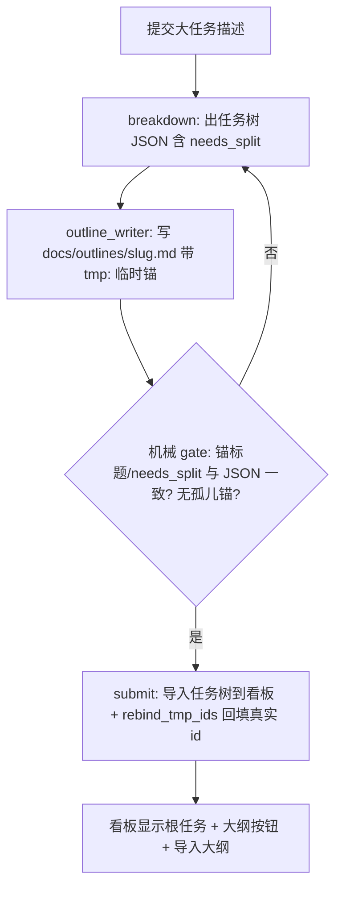

# 大纲驱动的任务拆分与学习工作流 — 设计规格

日期：2026-11-17
状态：设计已定稿，待用户审查；审查通过后进入 writing-plans 制定实现计划。
适用仓库：`latte-rs-agents`（工作目录 `/Users/zhouguodong/Documents/latte/latte-rs-agents`）。

## 1. 目标与范围

重新组织两条工作流，让"大任务拆分"和"学习"共享一棵由**大纲文档 + 看板任务树**双向对账的树：

1. **大任务拆分 workflow**：输入一条大任务，产出
   - 一份大任务总纲文档（Markdown 为权威源，可选导出只读 HTML）；
   - 一棵任务清单，每个任务显式标记 `needs_split`（是否需继续拆分）；
   - 导入任务看板；看板任务可点击打开大纲。
2. **子任务拆分 workflow**：对 `needs_split=true` 的任务按大纲与任务内容继续拆分，同时更新看板与大纲。
3. **学习 workflow**：根据任务内容与大纲写学习文档，文档关联大纲节点；子任务学习文档挂到父任务下，形成一棵文档树。

不在范围内：改动既有 `learn_plan` 的书籍目录算法（它继续产出章节树）；改 `/api/doc` 的鉴权模型；引入数据库。

## 2. 现状基线（含证据）

三份只读调研确认，以下三个概念**全仓不存在**（零匹配）：

| 概念 | 现状 | 证据 |
|---|---|---|
| `needs_split` 标记 | 无此字段。"要不要再拆"只是 prompt 约定；空 `subtasks` 是隐式叶子标记 | 全仓源码零匹配；`prompts/task_planner.md:76-78`、`config/workflows/task_refine.toml:119-121` |
| 独立大纲文档 | 通用拆分只出 `{"tasks":[...]}` JSON；学习拆分把目录编码进 `.latte/learn-plan/chapters.json`，无独立 md/html 大纲 | `config/workflows/implementation_plan.toml:50-57`、`config/workflows/learn_book_pages.toml:72-83` |
| 文档↔任务关联 | 学习文档是平的 `docs/learn/<slug>.md`，无 frontmatter；slug 的 `lat-<id>-` 前缀是唯一任务关联，发布时还被剥掉 | `latte-agent-core/src/learn_doc.rs:56`（`publish_name`）、`latte-agent-core/src/workflow.rs:8908-8948`（`LearnSlugPin`） |

已成熟、可直接复用的部分：

- **任务树**：`Task.parent_id` + `sub_order` 任意深度；导入递归写 `parent_id`；直接子任务全 done 时父任务自动 done（`maybe_complete_parent`）。Rust `Task` 见 `latte-agent-ui-server/src/tasks.rs:85-174`，`PlanTask` 见 `latte-agent-core/src/controller.rs:877-961`。
- **看板前端树渲染**：`latte-agent-cli/ui/src/task_board.ts` 的 `childTasksOf()`/`descendantIds()`/递归 `renderTaskNode()`/展开折叠、子任务进度 chip。
- **文档查看器**：`latte-agent-cli/ui/src/doc_viewer.ts:24` 的 `openDocViewer(path)` + 全局 `a.doc-link` 点击处理（`:109-120`），后端 `/api/doc`（`latte-agent-ui-server/src/handlers.rs:1644-1678`），白名单含 `docs/`（`:1557-1585`）。目前只接 chat，未接看板。
- **Markdown 渲染**：前端 markdown-it 栈（`latte-agent-cli/ui/package.json:19-24`、`markdown.ts:16-24`）。
- **导入/提交管线**：workflow → `PlanProposed` → 用户勾选 → `POST /api/tasks/import`（`handlers.rs:1243-1252`）；`submit_plan_from` 机械提交步（`workflow.rs:13625-13640`）。

## 3. 已定决策（本设计的约束）

| 编号 | 决策 | 含义 |
|---|---|---|
| D1 | 双向同步，各管一段 | 大纲管结构与叙述，看板管状态与执行，靠稳定 node-id 对账 |
| D2 | 大纲节点 = 任务，严格 1:1 | node-id 直接复用 `task.id`，不建映射表 |
| D3 | MD 权威，HTML 只读导出 | 工作副本只有 Markdown；HTML 是导出视图，不可编辑回写 |
| D4 | 学习文档跟随任务树，frontmatter 写归属 | 每篇文档写 `task_id`/`outline_node_id`/`parent_doc`/`order` |
| D5 | 交付到详细设计文档 | 本轮不改代码；审查后另立实现计划 |
| D6 | 只在根任务存大纲路径 | 子孙靠祖先链解析，TaskView 暴露 `effective_outline_path` |

## 4. 数据模型

### 4.1 看板 `Task` 新增字段

在 `latte-agent-ui-server/src/tasks.rs:85` 的 `Task` 结构上新增（全部 `#[serde(default)]` 以兼容旧落盘文件）：

```rust
/// 规划判定：是否仍需继续拆分。与"实际有无子任务"解耦——删掉子任务不丢规划意图。
#[serde(default)]
pub needs_split: bool,
/// 大纲文档路径（项目相对），仅在根任务写入；子孙通过祖先链解析。
#[serde(default, skip_serializing_if = "Option::is_none")]
pub outline_path: Option<String>,
/// 学习任务发布后的文档路径（项目相对），如 docs/learn/<slug>.md。
#[serde(default, skip_serializing_if = "Option::is_none")]
pub doc_path: Option<String>,
```

同步改动点：

- `TaskView`（`tasks.rs:261-280`）新增 `effective_outline_path: Option<String>`（由祖先链解析后填入）。
- TS 镜像 `TaskView`（`latte-agent-cli/ui/src/api.ts:1437-1478`）新增 `needs_split: boolean`、`outline_path: string | null`、`doc_path: string | null`、`effective_outline_path: string | null`。
- `CreateTaskBody` / `TaskPatchBody` / `ImportTask`（`tasks.rs:1129-1206`）支持这三个字段；`needs_split` 对拆分产物为**必填**（缺失时导入 400，原因：规划意图不可隐式推断）。手工 `POST /api/tasks` 创建缺省为 false。
- `ImportTask`（递归结构）逐节点透传 `needs_split`，`import_one`（`tasks.rs:1568`）写入每条 `Task`。

### 4.2 `PlanTask` 新增字段

在 `latte-agent-core/src/controller.rs:877` 的 `PlanTask` 上新增：

```rust
/// 是否仍需继续拆分。规划字段，与 subtasks 是否为空解耦。
#[serde(default)]
pub needs_split: bool,
```

配套改动：

- plan 工具输入 schema（`:7493-7501`）与已知键集合 `PLAN_TASK_KNOWN_KEYS`（`:7577-7580`）加入 `needs_split`，避免被当作未知键拒绝。
- `submit_plan_from`（`workflow.rs:13625-13640`）把该字段带进 `PlanProposed`。

### 4.3 node-id 约定

- 大纲锚点的稳定 id **最终就是 `task.id`**（如 `LAT-101`），不另建 id 空间、不建映射表。
- 层级由两处表达：大纲文档的标题嵌套 + 看板 `Task.parent_id`。
- **两阶段 id**：拆分 workflow 产出任务树时还没有真实 id（`board.json.next_seq` 在导入时才分配），此阶段大纲草案用**临时键** `tmp:<任务标题原文>` 作锚点（如 `<!-- node:tmp:模块一：xxx -->`）；标题即唯一键（workflow 已保证同清单内标题唯一）。
- **导入回填**：`submit` 步导入任务树拿到真实 id 后，由 `outline.rs::rebind_tmp_ids`（机械步，零模型）按"标题 → 真实 id"把所有 `tmp:` 锚点替换为真实 id 并写回大纲。此后大纲与看板共享同一 id 空间。
- 子任务拆分时父节点已有真实 id，新增子节点沿用两阶段（子节点用 `tmp:`，导入后回填）。

## 5. 大纲文档格式

### 5.1 位置与命名

- 路径：`docs/outlines/<slug>.md`（在 `/api/doc` 的 `docs/` 白名单内，无需改后端鉴权）。
- slug 由大任务标题生成，规则复用 `learn_doc.rs` 的 slug 规范化思路（小写、连字符、去特殊字符）。

### 5.2 文档结构（verbatim 示例）

```markdown
---
schema: 1
task_id: LAT-100
title: 大任务总纲
updated_at: 1784996760000
---
# 大任务总纲

<!-- node:LAT-100 -->
<!-- section:body:start -->
## 概述
叙述正文。人手维护，任何自动同步都不触碰本区块。
<!-- section:body:end -->

<!-- children:start -->
<!-- node:tmp:模块一：xxx needs_split -->
### 模块一：xxx
<!-- section:body:start -->
本节点的规划说明与验收口径……
<!-- section:body:end -->
<!-- learn-links:start -->
<!-- learn-links:end -->
<!-- node:tmp:模块二：yyy -->
### 模块二：yyy
<!-- section:body:start -->
……
<!-- section:body:end -->
<!-- children:end -->
```

说明：这是**导入前**的大纲草案，子节点用 `tmp:` 临时键。导入后 `rebind_tmp_ids` 把它们换成 `LAT-101`/`LAT-102` 等真实 id；学习链接由学习 workflow 回写（§7.4），故草案阶段 `learn-links` 区块为空。

### 5.3 受控区块规则

- **锚点**：`<!-- node:<task-id> -->` 标记一个任务节点；导入前为 `tmp:<标题>`、导入后为真实 `task.id`；可选 `needs_split` 标记表示该节点仍需拆分。
- **受控区块**：`<!-- section:body:start/end -->` 包住叙述正文；`<!-- children:start/end -->` 包住子节点列表；`<!-- learn-links:start/end -->` 包住学习链接。
- **权威划分**：受控区块由引擎写入/重写；区块外内容（frontmatter 的 `title`、文档级前言、任何未加锚的自由文本）视为人手维护，机器同步时**原样保留**。
- 这是"重生成不丢内容"的核心：同步只改锚点和受控区块内部，从不整篇覆写。

## 6. 模块划分

| 模块 | 文件 | 职责 |
|---|---|---|
| 大纲解析/渲染/对账 | `latte-agent-core/src/outline.rs`（新） | `OutlineDoc`/`OutlineNode` 结构；`parse_outline`/`render_outline` 往返幂等；`sync_with_tasks` 按 id 对账；`rebind_tmp_ids` 把 `tmp:` 锚点换成真实 task.id；受控区块的保留式重写 |
| 大纲同步命令与 API | `latte-agent-core/src/controller.rs`、`latte-agent-ui-server/src/handlers.rs` | `outline_sync` 工具；`POST /api/outlines/:task_id/sync` 端点 |
| 看板任务扩展 | `latte-agent-ui-server/src/tasks.rs` | 新字段持久化、`effective_outline_path` 解析、递归导入写标记、结构同步 |
| 大任务拆分 workflow | `config/workflows/outline_split.toml`（新） | 输入大任务 → 任务树 JSON + 大纲草案 + 机械 gate + 提交 |
| 子任务拆分 workflow | `config/workflows/task_refine.toml`（改） | 复用现有五步，增加大纲补丁步与 needs_split 输出 |
| Prompt | `prompts/outline_writer.md`（新）、`prompts/task_planner.md`（改） | 写大纲骨架、输出 needs_split |
| 学习发布 | `latte-agent-core/src/learn_doc.rs`、`workflow.rs` | 发布时写 frontmatter、回写大纲 learn-links 区块 |
| 看板 UI | `task_board.ts`、`doc_viewer.ts`、`api.ts` | 大纲按钮、学习链接、needs_split chip、HTML 导出 |
| HTML 导出 | `latte-agent-cli/ui/src/markdown.ts`（已有 markdown-it） | MD → 只读 HTML 单页，前端 Blob，零后端改动 |

## 7. 核心流程

### 7.1 大任务拆分（outline_split）



workflow 步骤设计（沿用 `task_refine.toml:54-287` 已验证的结构）：

1. **breakdown**：`task_planner`，摘掉 plan 工具，输出"拆分依据 + 恰好一个 `{"tasks":[...]}` JSON fence"，每项含既有字段 + `needs_split`。引擎 `require_plan_tasks` 机械校验（路径存在性、字符串层重叠、workflow/task_type 名）。
2. **outline_draft**：`outline_writer`（新角色），读 `{{draft}}` 的任务树，输出大纲 Markdown（含 `tmp:<标题>` 临时锚、每个节点一段 body、needs_split 标记）。body 从各任务的 `description` 派生。
3. **gate**：`reviewer`，产出 `VERDICT: ACCEPT/REVISE/REJECT`，`loop_back_to="breakdown"`，`loop_abort_on="VERDICT: REJECT"`（`max_iterations=2`）。机械 gate 追加校验：大纲锚点的**标题集合**与 JSON 任务标题集合一一对应、needs_split 一致、无孤儿锚点（此阶段锚是 `tmp:`，按标题对账）。
4. **submit**：`submit_plan_from="final_draft"`（零模型）提交 plan 导入看板拿到真实 id → `outline.rs::rebind_tmp_ids` 按"标题→真实 id"回填锚点并落盘 `docs/outlines/<slug>.md`。两步在同一提交中完成。

### 7.2 子任务拆分（task_refine 改造）

仅对 `needs_split=true` 的任务开放（后端在 `POST /api/tasks/:id/refine` 前置校验，false 时 409 + 提示"叶子任务不可再拆"）。

在现有五步基础上：

- **refine** prompt 追加：输出每个子任务的 `needs_split`。
- **new step `outline_patch`**（在 submit 前）：复用 `patch_from` 机制，输出 `{"ops":[{"op":"insert_child","parent":"<父节点 id>","task":"<子任务标题>","needs_split":bool,"body":"..."}]}`。引擎按父节点真实 id 定位，在大纲 `children` 区块下插入带 `tmp:<标题>` 锚的子节点段，保留其余区块。
- **submit**：写看板子任务（带 `parent_id`）→ `rebind_tmp_ids` 回填子节点真实 id → 落盘更新后大纲。三步在同一提交中完成，按 id 对账。

### 7.3 双向同步与冲突规则

沿用 D1"各管一段"：

| 领域 | 权威 |
|---|---|
| 大纲 | 结构（节点/层级/标题/needs_split 标记）、叙述正文 |
| 看板 | state、scheduled_at、runs、history、depends_on、priority、workflow、paths、dispatch_pending、isolated、worktree |
| 共享需对账 | 节点存在性、层级、id、title、needs_split |

同步触发：

- 拆分 workflow 同时写两边，按 id 对账（§7.1/§7.2）。
- 手改大纲后：`POST /api/outlines/:task_id/sync` 把结构变更同步到看板（只动 id/title/parent_id/needs_split，不碰执行状态）。
- 看板 PATCH title/hierarchy/needs_split：反向写大纲对应锚点（只动锚点行与受控结构区块，不碰 body）。

冲突规则（串行执行，无并发锁，显式操作胜，时间戳定序）：

1. **title 两边都改** → 最后显式操作覆盖，写入时比较 `updated_at`，输的一方以 history/hint 记录被覆盖。
2. **一边删除、另一边修改** → 删除胜；被删节点的叙述 body 移入 `docs/outlines/.trash/<id>-<ts>.md` 保留，可恢复。
3. **id 在对面不存在** → 视为新增；若 `.trash/` 中曾存在同 id，则提示用户"恢复 / 新建"二选一，不静默新建。
4. **needs_split=false 但已存在子任务** → 以实际子任务为准告警，不自动改（避免误删规划好的子树）。

限权：`/api/outlines/:task_id/sync` 只接受白名单字段（id/title/parent_id/needs_split），拒绝执行状态字段；路径限定在 `docs/outlines/` 下，防越权写。

### 7.4 学习 workflow

学习任务由看板派发（`task_type=learn` / `workflow=learn_loop`，slug 带 `lat-<id>-` 前缀锁定会话）。

1. **plan → annotate → doc_review → novice 循环 → read_confirm → quiz → supplement → merge**：沿用现有 `config/workflows/learn_loop.toml` 全部步骤，不改学习逻辑本身。
2. **finalize_learn_doc**（`workflow.rs:9330` 改造）：发布 `docs/learn/<slug>.md` 时写入 frontmatter：

```yaml
---
task_id: LAT-101
outline_node_id: LAT-101
parent_doc: null          # 或父学习任务的 docs/learn/<parent>.md
order: 0
outline: ../outlines/<大任务 slug>.md
---
```

- `task_id`/`outline_node_id` 从 slug 的 `lat-<id>-` 前缀解析（`LearnSlugPin`，`workflow.rs:8908-8948`）；发布文件名继续用 `publish_name` 剥前缀（`learn_doc.rs:56`），但归属信息进 frontmatter，不依赖 slug。
- `parent_doc`/`order` 从看板 `parent_id` + `sub_order` 解析（查 `TaskStore`）。
3. **link_outline**（新增引擎机械步，在 merge 后）：更新大纲对应节点的 `learn-links` 区块，追加/替换 `- 学习笔记：[title](../learn/<slug>.md)（task <id>）`；按 frontmatter 生成父目录 `docs/learn/<大任务>/index.md`（镜像任务树）。只替换受控区块，保留其余内容。

结果：学习文档随任务树形成一棵镜像树——父任务的学习文档是 index，子任务文档挂其下，每篇带归属 frontmatter。

## 8. HTML 导出

- 源文件只有 Markdown（D3）。看板任务抽屉增加"导出 HTML"按钮：前端 `/api/doc` 取 MD → `renderMarkdown()`（markdown-it，内联样式）→ `Blob` + `URL.createObjectURL` 在新窗口打开。
- `/api/doc` 无需改造。HTML 是只读视图，不可编辑回写。
- 看板"打开大纲"按钮：任务有 `effective_outline_path` 时，渲染 `<a class="doc-link" data-doc-path="<path>">大纲</a>`，复用已安装的 `installDocLinkHandler()`（`main.ts:122`）——它读 `data-doc-path` 并调 `openDocViewer(path)`（`doc_viewer.ts:109-120`），后端 `/api/doc?path=<rel>` 取 MD。

## 9. 验证计划

**单元测试**

- `outline.rs`：parse→render 幂等；插入/删除/移动节点保留 body；needs_split 解析；孤儿锚点保留；`.trash` 归档。
- `tasks.rs`：三个新字段持久化、旧文件缺省兼容；递归导入写 needs_split；`effective_outline_path` 祖先链解析；sync 不改执行状态。
- workflow gate：锚标题与任务标题不一致 / needs_split 与子节点矛盾 / 孤儿锚 → 拒绝；`rebind_tmp_ids` 回填后所有 `tmp:` 锚消失且 id 与看板一致。
- `learn_doc.rs`：frontmatter 写入、slug 剥前缀但 task_id 保留、link_outline 只替换受控区块。

**集成/冒烟**

1. 跑一次大任务拆分：看板出现任务树（含 needs_split chip）、根任务有"打开大纲"和"导出 HTML"按钮；点开大纲显示 node 锚与 body；导出 HTML 可读。
2. 对一个 needs_split=true 任务跑子任务拆分：看板出现子节点、大纲对应节点下出现子锚，两边 needs_split 一致。
3. 跑一次 learn_loop：发布文档带 frontmatter，大纲出现 learn-links，父目录 index 反映树结构。
4. 手改大纲 title 后调用 sync：看板 title 更新、state/runs 不变；再反向 PATCH 看板 title：大纲锚点更新、body 不变。
5. 冲突场景：一边删除一边修改 → 删除胜且 body 进 `.trash`。

**文档**

- 新增本设计文档（已完成，即本文件）。
- 更新 stale 的 `docs/task-board-design.md:133`（Task JSON 示例缺 paths/artifact_paths/depends_on 等字段，且需补 needs_split/outline_path/doc_path）。
- 更新 `docs/learn-loop-doc-driven-design.md` 一处：其 §5 已标注过期，本设计补上 frontmatter 与树关联的说明。

## 10. 取舍与风险

| 项 | 决策 | 代价/缓解 |
|---|---|---|
| 不建独立映射表 | node-id = task.id（D2） | id 无层级语义；层级靠 parent_id 表达，大纲靠嵌套——可接受 |
| 只根任务存路径 | outline_path 仅根任务（D6） | 查子孙大纲走祖先链；TaskView 缓存 effective_outline_path |
| 大纲→看板 sync 新 API | 引入结构变更入口 | 白名单字段 + 路径限定 + 只动结构字段限权 |
| 双写风险 | MD 权威、HTML 只读（D3） | HTML 不可编辑回写（明确取舍） |
| 学习树不改学习逻辑 | 仅改发布与回写 | learn_plan 现有 chapters.json 目录算法保留，靠 sync 对账；不推翻既有事故修复 |
| 无并发锁 | 显式操作胜 + 时间戳 | 罕见并发下后写覆盖先写；用 history 留痕、可恢复 |

## 11. 实现顺序建议（供 writing-plans 参考）

1. 数据层：`Task`/`PlanTask`/TS `TaskView` 新字段 + 持久化 + 导入。
2. `outline.rs` 解析/渲染/对账 + 单测。
3. 看板 UI：大纲按钮、needs_split chip、HTML 导出。
4. 大任务拆分 workflow + outline_writer 角色/prompt + gate。
5. 子任务拆分改造 + outline_patch + sync API。
6. 学习发布 frontmatter + link_outline + 父目录 index。
7. 文档更新与全量冒烟。

实现计划阶段需把每步拆到具体函数签名、diff 范围与测试用例；本规格不预先固化实现细节。
